<div align="center">

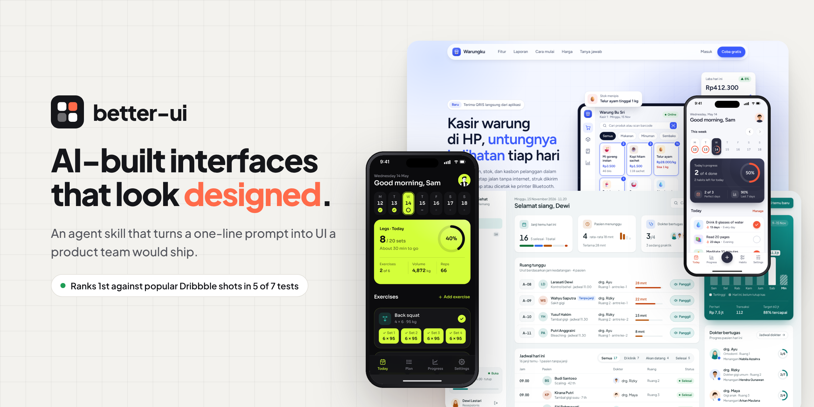

<br>

[](better-ui/SKILL.md)
[](#quick-start)
[](#results)
[](#whats-inside)
[](LICENSE)

**Ask an agent for a page. Get something a product team would ship.**

[Quick start](#quick-start) · [Before and after](#before-and-after) · [Results](#results) · [How it works](#how-it-works) · [FAQ](#faq)

</div>

<br>

AI agents build interfaces that are either **too plain** (default components, no brand, it reads as rendered HTML) or **too much** (invented themes, textures, display fonts, it reads as a costume). **better-ui** is an agent skill that aims at the narrow middle where popular Dribbble work lives: familiar patterns, executed with precision.

You don't call it. Ask for any screen and the agent loads it on its own.

## Quick start

```bash
npx skills add zeative/better-ui-skills
```

That uses the open [skills CLI](https://github.com/vercel-labs/skills) and works with Claude Code, Codex, Cursor and other agents that read `SKILL.md`. Prefer to copy it yourself?

```bash
git clone https://github.com/zeative/better-ui-skills.git && cp -r better-ui-skills/better-ui ~/.claude/skills/
```

Then ask for something visual:

```text
make me a habit tracker web app. i want to add habits, tick them off each day and see my streaks
```

## Before and after

Same prompt. Same model. Each page was built by a separate agent session in its own empty folder; the one on the right had better-ui installed and was never told about it. Nothing was edited by hand.

<table>
<tr>
<td width="36%" align="center"></td>
<td width="64%" align="center">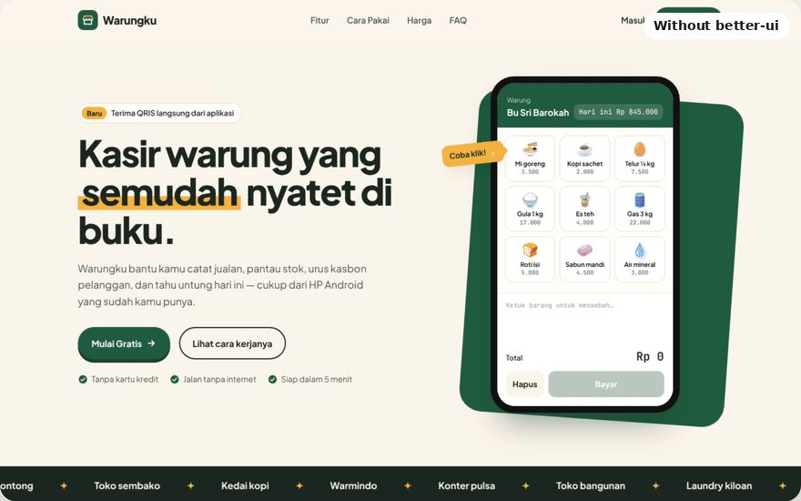</td>
</tr>
<tr>
<td align="center"><sub><i>"make a workout tracker app. today's workout with exercises, sets and reps i can tick off, and my progress for the week"</i></sub></td>
<td align="center"><sub><i>"Bikin landing page buat Warungku, aplikasi kasir (POS) buat warung dan UMKM."</i></sub></td>
</tr>
</table>

<table>
<tr>
<th width="50%">Without better-ui</th>
<th width="50%">With better-ui</th>
</tr>
<tr><td colspan="2"><b>Dental clinic dashboard</b> · <i>"Buatkan dashboard untuk klinik gigi kecil: jadwal janji temu hari ini, pasien yang sedang menunggu, dokter yang bertugas, dan pendapatan minggu ini."</i></td></tr>
<tr>
<td><a href="docs/images/compare/clinic-dashboard-before.jpg"></a></td>
<td><a href="docs/images/compare/clinic-dashboard-after.jpg"></a></td>
</tr>
<tr><td colspan="2"><b>Store admin dashboard</b> · <i>"Bikin halaman dashboard admin untuk toko online kecil yang jualan biji kopi. Tampilkan ringkasan penjualan hari ini, grafik penjualan 7 hari terakhir, pesanan terbaru, dan produk terlaris."</i></td></tr>
<tr>
<td><a href="docs/images/compare/store-admin-dashboard-before.jpg"></a></td>
<td><a href="docs/images/compare/store-admin-dashboard-after.jpg">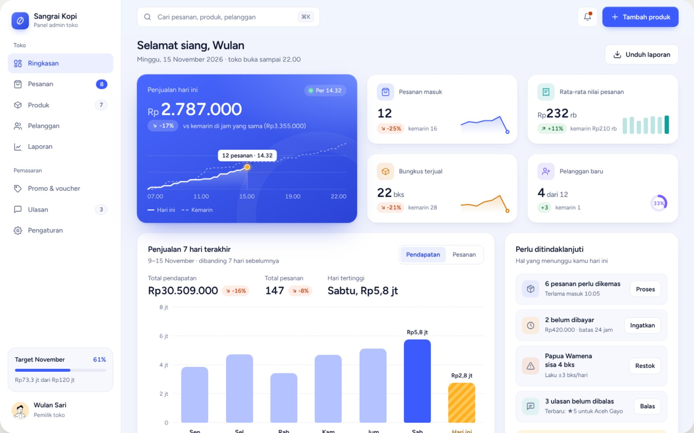</a></td>
</tr>
<tr><td colspan="2"><b>Habit tracker</b> · <i>"make me a habit tracker web app. i want to add habits, tick them off each day and see my streaks. single index.html file, and it should work on my phone too"</i></td></tr>
<tr>
<td align="center"><a href="docs/images/compare/habit-tracker-app-before.jpg"></a></td>
<td align="center"><a href="docs/images/compare/habit-tracker-app-after.jpg">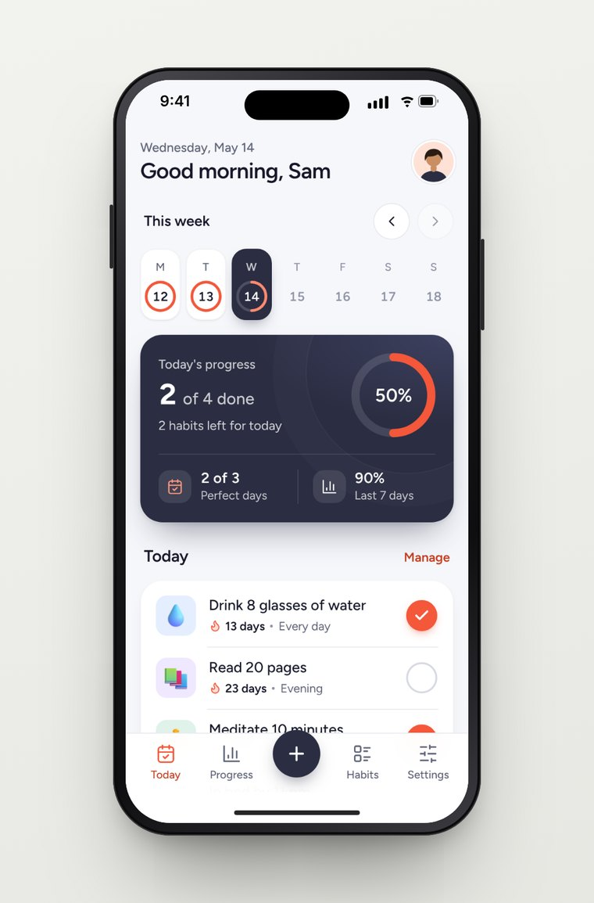</a></td>
</tr>
</table>

<details>
<summary><b>Two more pairs, where the difference is smaller</b></summary>

<br>

Current models are already decent at some of these. These are the cases where better-ui changed the least.

<table>
<tr><th width="50%">Without better-ui</th><th width="50%">With better-ui</th></tr>
<tr><td colspan="2"><b>SaaS landing page</b> · <i>"Build a landing page for Ledgerly, an invoicing tool for freelancers. It needs a hero, a features section, pricing, and a signup call to action."</i></td></tr>
<tr>
<td>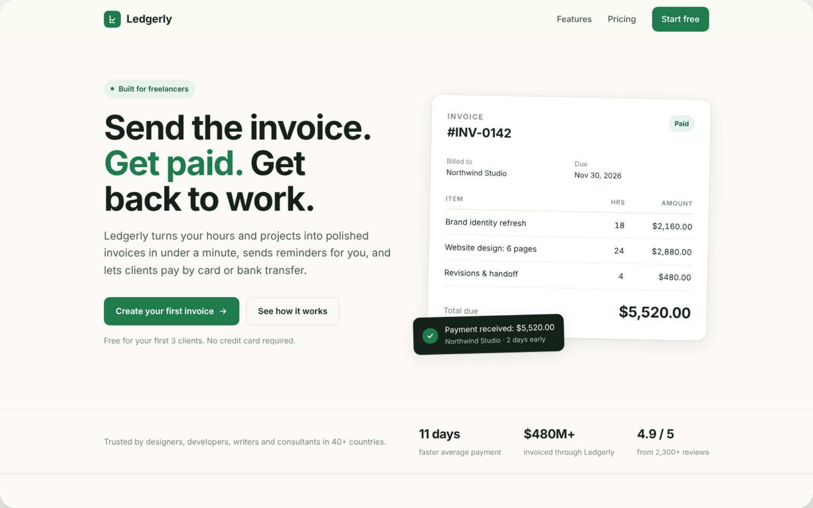</td>
<td>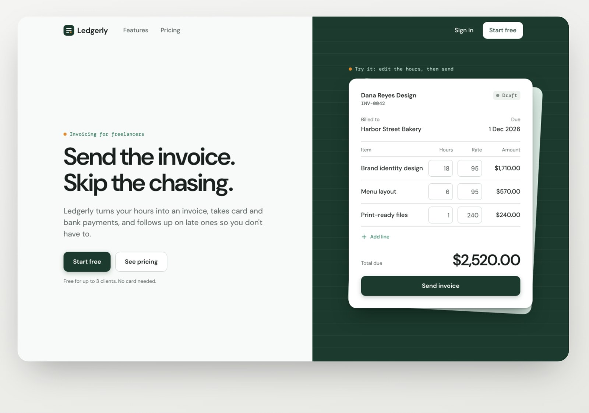</td>
</tr>
<tr><td colspan="2"><b>Personal finance app</b> · <i>"build a personal finance app: balance, recent transactions, spending by category and a monthly budget."</i></td></tr>
<tr>
<td align="center">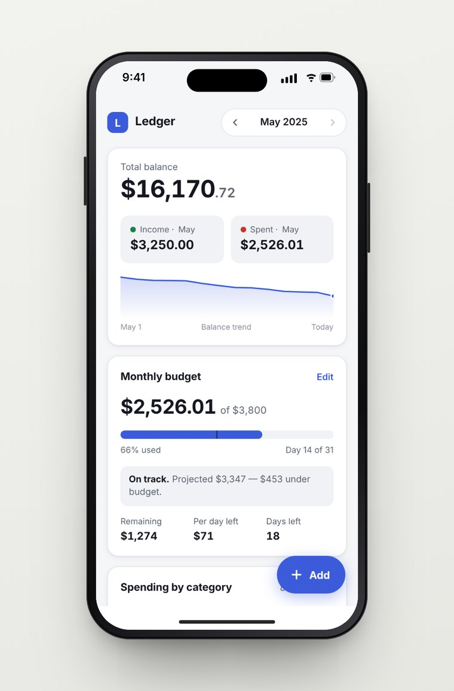</td>
<td align="center"></td>
</tr>
</table>

</details>

### Ten more prompts, no judges

Ten new prompts, run the same way with the current version of the skill, both sides shown as they came out. Nothing was ranked or picked by a judge, and all ten are here: six below and four in the fold.

<table>
<tr>
<th width="50%">Without better-ui</th>
<th width="50%">With better-ui</th>
</tr>
<tr><td colspan="2"><b>Coffee ordering app</b> · <i>"Bikin aplikasi pesan kopi buat kedai kopi kecil: menu, keranjang, dan status pesanan. Satu file index.html, mobile first."</i></td></tr>
<tr>
<td align="center"><a href="docs/images/compare/coffee-order-before.jpg">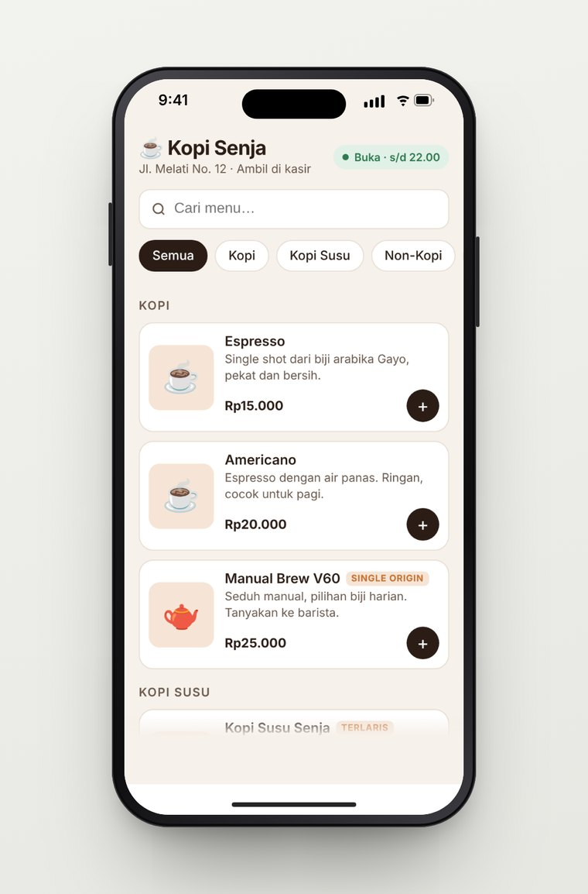</a></td>
<td align="center"><a href="docs/images/compare/coffee-order-after.jpg">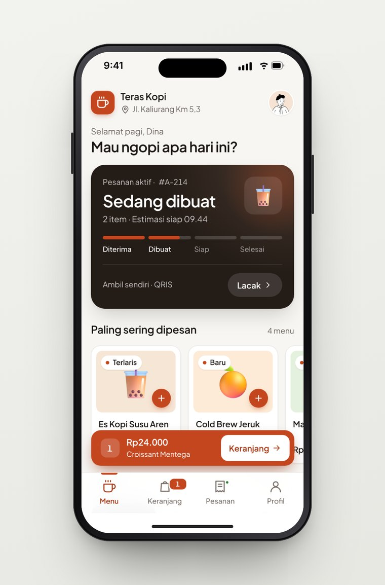</a></td>
</tr>
<tr><td colspan="2"><b>Kanban board</b> · <i>"make a kanban board web app for a small product team: columns, task cards with assignees and due dates, and a way to add tasks. single index.html"</i></td></tr>
<tr>
<td><a href="docs/images/compare/kanban-board-before.jpg">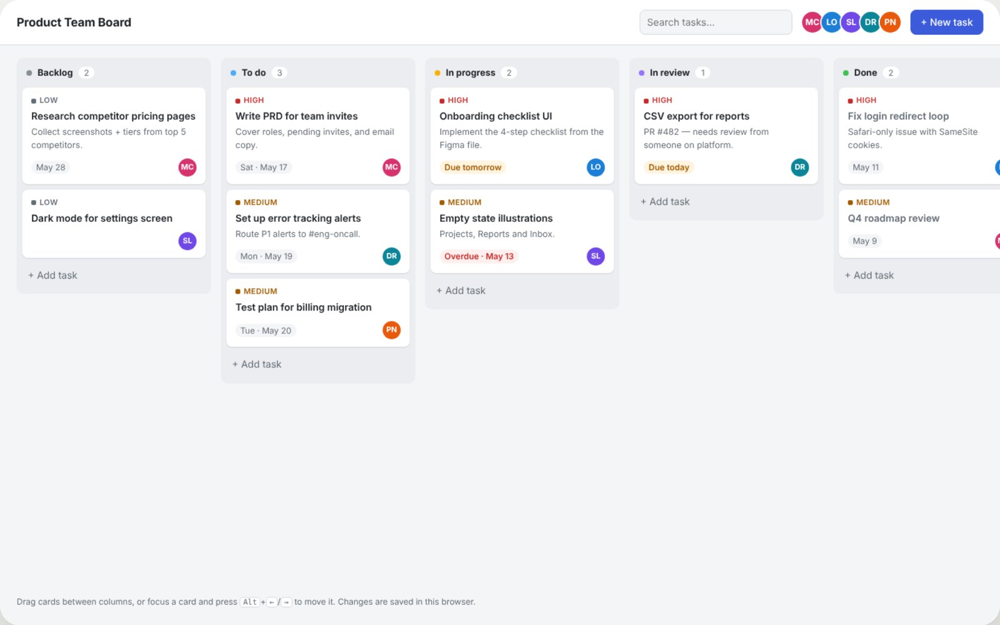</a></td>
<td><a href="docs/images/compare/kanban-board-after.jpg">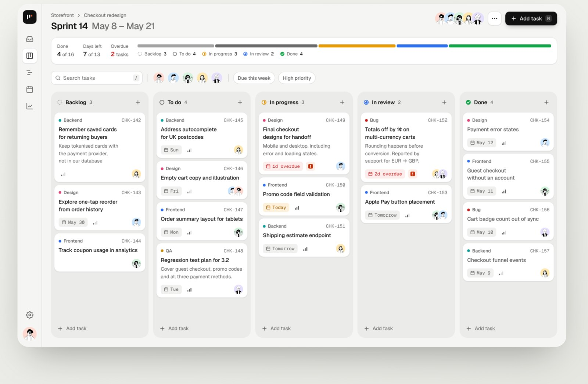</a></td>
</tr>
<tr><td colspan="2"><b>SaaS analytics dashboard</b> · <i>"build a web analytics dashboard for a SaaS product: visitors, signups, conversion, traffic sources and top pages. dummy data, single index.html"</i></td></tr>
<tr>
<td><a href="docs/images/compare/analytics-dashboard-before.jpg">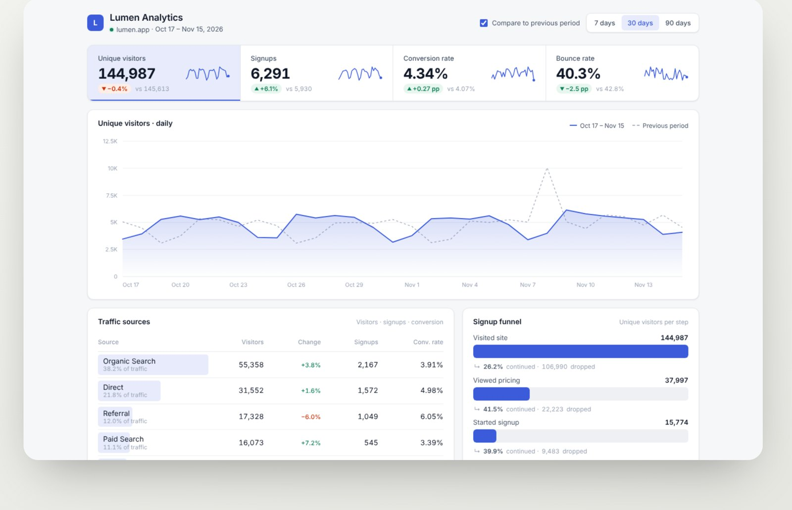</a></td>
<td><a href="docs/images/compare/analytics-dashboard-after.jpg"></a></td>
</tr>
<tr><td colspan="2"><b>Meditation and sleep app</b> · <i>"make a meditation and sleep app: today&#x27;s session, a library of guided sessions, and a weekly mindfulness streak. single index.html, mobile first"</i></td></tr>
<tr>
<td align="center"><a href="docs/images/compare/meditation-app-before.jpg">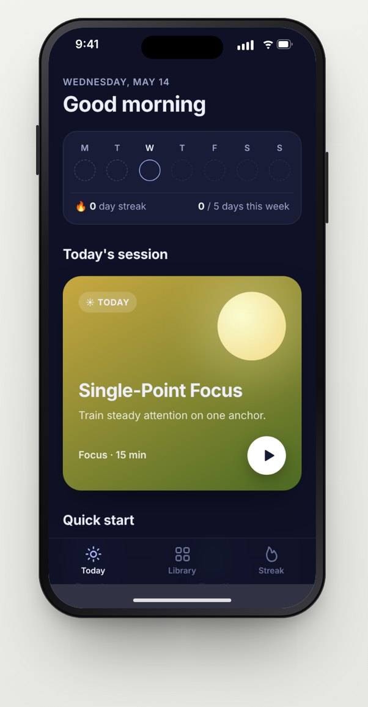</a></td>
<td align="center"><a href="docs/images/compare/meditation-app-after.jpg">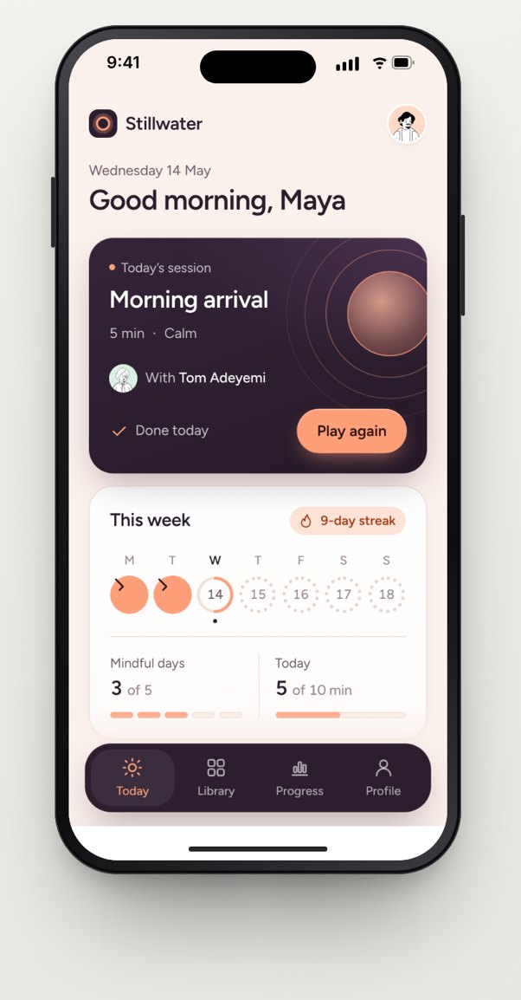</a></td>
</tr>
<tr><td colspan="2"><b>Student dashboard</b> · <i>"Bikin dashboard siswa untuk aplikasi belajar online: jadwal kelas hari ini, tugas yang belum dikumpulkan, nilai, dan progres kursus. Data dummy, satu file index.html."</i></td></tr>
<tr>
<td><a href="docs/images/compare/student-dashboard-before.jpg"></a></td>
<td><a href="docs/images/compare/student-dashboard-after.jpg"></a></td>
</tr>
<tr><td colspan="2"><b>Music player</b> · <i>"make a music player app: now playing with controls, a queue, and a library of playlists. single index.html, mobile first"</i></td></tr>
<tr>
<td align="center"><a href="docs/images/compare/music-player-before.jpg"></a></td>
<td align="center"><a href="docs/images/compare/music-player-after.jpg">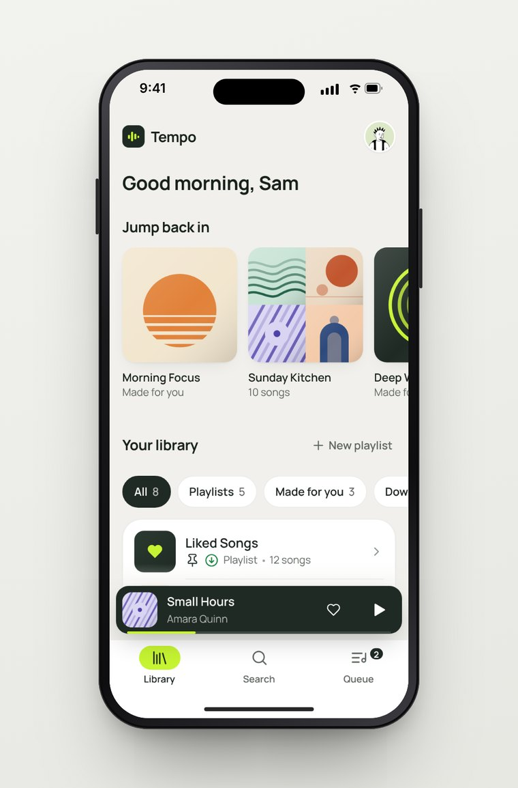</a></td>
</tr>
</table>

<details>
<summary><b>The other four</b></summary>

<br>

<table>
<tr><th width="50%">Without better-ui</th><th width="50%">With better-ui</th></tr>
<tr><td colspan="2"><b>Crypto portfolio tracker</b> · <i>"build a crypto portfolio tracker app: total balance, holdings with price changes, a chart and recent transactions. single index.html, mobile first"</i></td></tr>
<tr>
<td align="center"><a href="docs/images/compare/crypto-portfolio-before.jpg">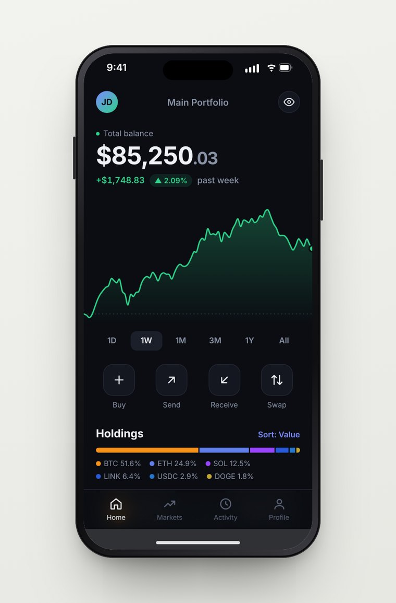</a></td>
<td align="center"><a href="docs/images/compare/crypto-portfolio-after.jpg"></a></td>
</tr>
<tr><td colspan="2"><b>Recipe app</b> · <i>"make a recipe app: browse recipes by category, a recipe detail with ingredients and steps, and saved favourites. single index.html, mobile first"</i></td></tr>
<tr>
<td align="center"><a href="docs/images/compare/recipe-app-before.jpg">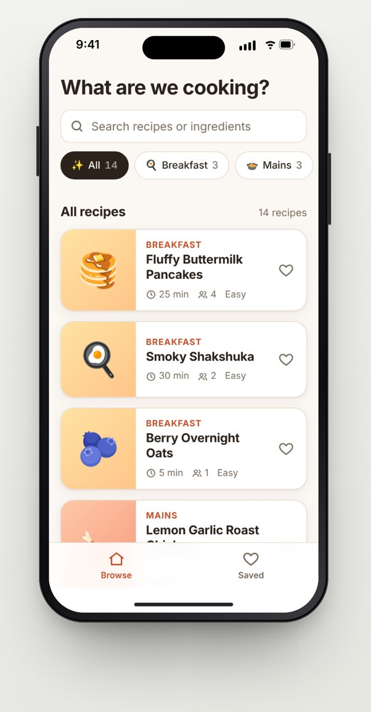</a></td>
<td align="center"><a href="docs/images/compare/recipe-app-after.jpg">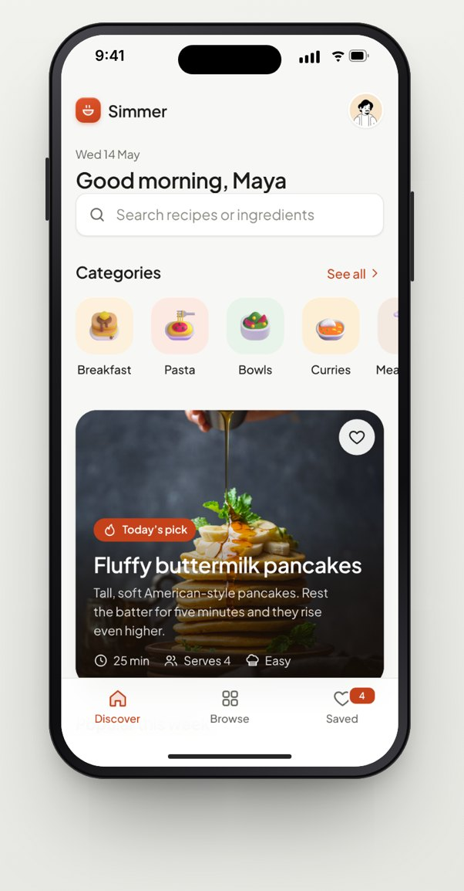</a></td>
</tr>
<tr><td colspan="2"><b>Bali villa landing page</b> · <i>"Bikin landing page buat villa sewaan di Bali: foto, fasilitas, harga per malam, ulasan tamu, dan tombol booking. Satu file index.html."</i></td></tr>
<tr>
<td><a href="docs/images/compare/villa-landing-before.jpg">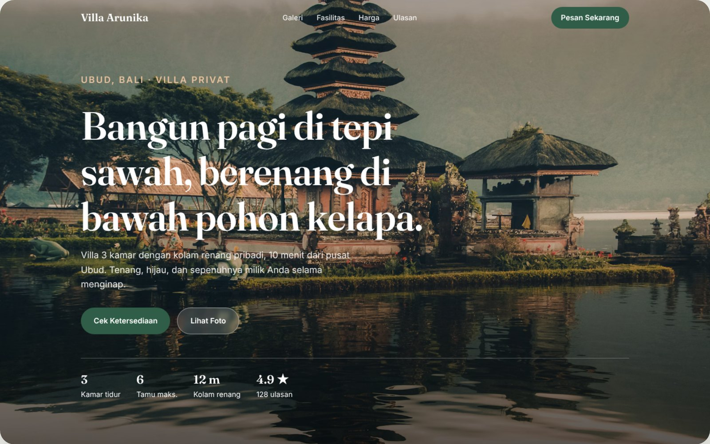</a></td>
<td><a href="docs/images/compare/villa-landing-after.jpg"></a></td>
</tr>
<tr><td colspan="2"><b>Sneaker product page</b> · <i>"build a product page for an online sneaker store: gallery, sizes, colours, price, reviews and add to cart. single index.html"</i></td></tr>
<tr>
<td><a href="docs/images/compare/sneaker-product-before.jpg">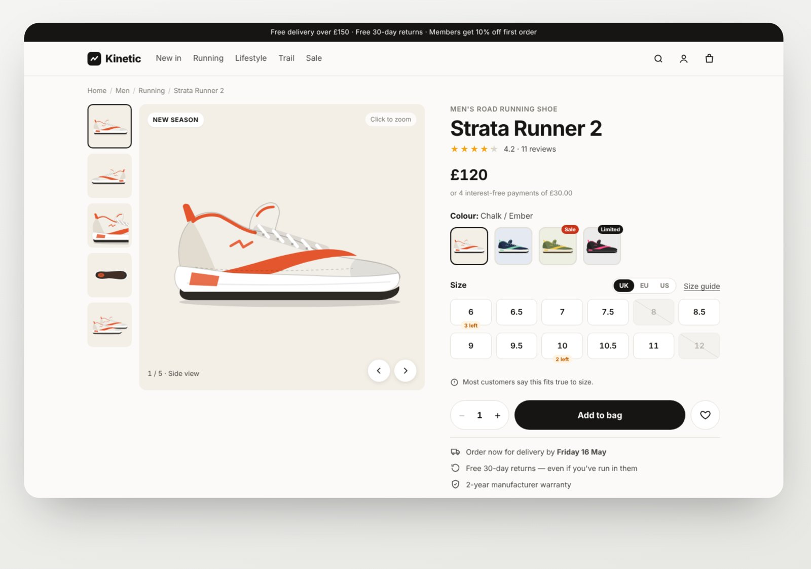</a></td>
<td><a href="docs/images/compare/sneaker-product-after.jpg">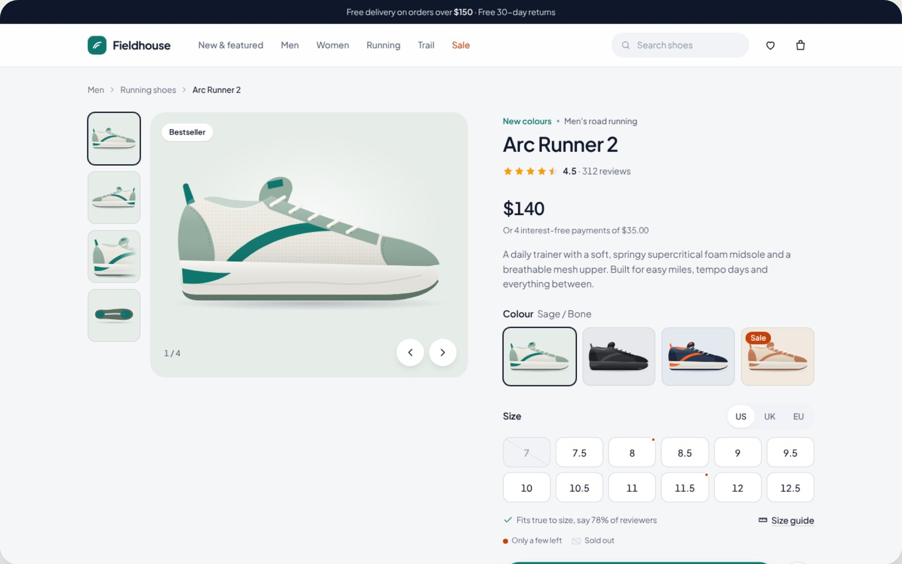</a></td>
</tr>
</table>

</details>

Every page is in [`examples/`](examples). Open them in a browser and click around.

## Results

A screenshot proves little on its own, so each page was **hidden among eight popular Dribbble shots** of the same category and a judge ranked all nine, flagging anything that looked AI-made.

| Case | Rank among 9 | Judged |
|:---|:---:|:---|
| Habit tracker | 🥇 **1st** | genuine |
| Dental clinic dashboard ✱ | 🥇 **1st** | genuine |
| Workout tracker | 🥇 **1st** | possibly AI-made |
| POS landing page ✱ | 🥇 **1st** | possibly AI-made |
| Store admin dashboard | 🥇 **1st** | possibly AI-made |
| SaaS landing page | **1st**, **3rd** | possibly AI-made |
| Personal finance app | **1st**, **7th** | possibly AI-made |

<sub>✱ Prompts never used while developing the skill. On the same test, a page built without the skill ranked 8th of 9, and an earlier version of this skill that pushed themed concepts also ranked 8th.</sub>

## What it changes

- **No themes, no costumes.** A habit tracker is not a stamp card and a budget is not an abacus. Character comes from colour, type, icons and finish.
- **A look that isn't the default.** Left alone, agents reach for the same indigo gradient or emerald green. `look.cjs` deals a contemporary palette and font for the product's category.
- **The conventional layout, done well.** Native app anatomy, a real dashboard shell, the landing sections people expect, plus one signature chart drawn the way current shots draw them.
- **Apps open alive.** Believable sample data in a mid-use state, never an empty shell.
- **Copy a real product would ship.** No captions explaining the chart, no "these are sample habits", no contradictions, no stock merchant names.
- **It checks its own work.** It renders the page at three widths, measures it, and has a fresh reviewer ask one question: would this pass as a real product?

## How it works

```text
1. Whose design is it?       existing product → fit its system · a brand → follow it · blank → continue
2. Understand the job        what the screen is for and who uses it; write the real content first
3. Set up the system         deal a look; one sans family, compact type scale, one brand colour
4. Conventional layout       native app anatomy · dashboard shell · landing sections · a signature chart
5. Build it properly         every width, every state, the accessibility floor, the finish
6. Render, audit, review     screenshot, measure, independent review, fix
7. Hand off plainly          what was built and what is placeholder
```

## What's inside

```text
better-ui/
├── SKILL.md                 the process the agent follows
├── references/
│   ├── system.md            looks, type, colour by category, surfaces, icons, imagery, tokens
│   ├── product-ui.md        mobile apps, dashboards, admin; signature moments per category
│   ├── marketing.md         landing and pricing pages; the stock AI hero recipe to avoid
│   ├── editorial.md         portfolios, studios, restaurants and other image-led sites
│   ├── showpiece.md         summary cards, product mocks, charts, avatars, icons in code
│   ├── polish.md            surfaces, shadows, type, colour, controls, motion
│   ├── critique.md          what the bar looks like, the two failures, the reviewer brief
│   └── craft.md             contrast, type scale, layout, states, accessibility
└── scripts/
    ├── audit.cjs            renders a page at 3 widths and reports measured problems
    └── look.cjs             deals a contemporary look per category
```

Markdown plus two Node scripts. No runtime dependencies.

<details>
<summary><b><code>audit.cjs</code>: what it measures</b></summary>

<br>

```bash
node better-ui/scripts/audit.cjs path/to/index.html --out .ui-audit
```

| Group | Checks |
|:---|:---|
| Broken | horizontal overflow, console errors, text covered by other elements, content under fixed bars, words run together |
| Accessibility | WCAG AA contrast, visible focus, labels and names, tap targets, heading order |
| Craft | textures and noise, serif or second text family on product UI, oversized type, one icon reused for different items, clipped text, half-empty cards, near-miss alignment, awkward wraps |
| Richness | first screen with no visual, screens of text only, text on a bare page, a pastel rainbow |

Options: `--setup seed.js` runs a script first, `--register showcase` relaxes card checks for image-led sites, plus `--dark`, `--widths` and `--json`. It needs Node and a Chromium that Playwright can drive.

</details>

<details>
<summary><b><code>look.cjs</code>: dealing a look</b></summary>

<br>

```console
$ node better-ui/scripts/look.cjs "Tally" finance
look:    fresh gradient
canvas:  #F3F6FB
brand:   #1F4BFF
accent:  #7DD3FC
font:    Plus Jakarta Sans
how:     deep blue payment card with a soft sky gradient, white glassy cards
```

Same product name, same look, every time. Categories: finance, fitness, habits, wellness, health, productivity, commerce, saas, food, travel, other.

</details>

## How it was tested

<details>
<summary><b>The line-up test</b></summary>

<br>

1. **Build in isolation.** A headless agent session in an empty folder gets a one-line prompt that never mentions the skill.
2. **Present it like a shot.** The page is rendered the way Dribbble shows designs: phones in device frames, dashboards in a browser window, landing pages as a long scroll, with the clock frozen to a neutral date.
3. **Hide it.** The shot is shuffled among eight popular shots of the same category.
4. **Judge blind.** The judge is told only that some shots may be AI-made fakes. It ranks all nine and flags fakes. A page passes when it ranks in the top half and is not flagged as likely fake.

Before it was trusted, the test was calibrated against a human reviewer's verdicts on earlier pages, and agreed every time: plain pages ranked 8th ("rendered HTML"), themed pages the human had rejected ranked 8th ("costume, not function").

</details>

<details>
<summary><b>What failed along the way</b></summary>

<br>

About twenty rounds of build → judge → change, each scored with the judges' reasons.

- **Restraint alone** produced honest pages that judges called wireframes.
- **Art-direction libraries and detailed showpieces** lifted scores but still read as templates.
- **"One ownable idea" per product** won on an AI rubric and produced stamp-card habit trackers and abacus budget apps that a human found forced. The rubric was the problem, so the test became the line-up.
- **Conventional anatomy, a strict system and plain copy** fixed the overdesign. Dealing the look, banning give-away copy and one signature chart fixed the "generic template" verdicts.

</details>

## FAQ

**Which agents does it work with?**
It was built and tested with Claude Code. The format is the open `SKILL.md` standard, so agents that support skills can load it; the render-and-audit step needs one that can run Node.

**Does it need a browser?**
For the audit, yes: Node plus a Chromium that Playwright can drive. Without one the skill still works and reviews the source instead, and says so in its handoff.

**Will it restyle my existing app?**
No. In a codebase with a design system it reads your tokens and components and works inside them. The look, fonts and palette rules only apply to a blank slate.

**Why not just write a better prompt?**
A prompt can ask for "clean and modern". The skill adds the parts a prompt can't carry: a tested system, the conventional anatomy for each kind of screen, a list of give-aways to avoid, an audit that measures the result, and a review loop.

**What does it cost?**
Roughly 10 to 20 minutes and 2 to 5 dollars of model usage per page, against 2 to 4 minutes without it, because it renders, audits and reviews its own work.

**Is the sample content real?**
No. Names, figures, testimonials and logos are fictional. Replace them before you publish anything.

**Who judged the results?**
AI judges, calibrated against one person's verdicts. Ranks move by a place or two between judges. Your own eye is the real test, which is why every page is in the repo.

## Sources

<details>
<summary>Writing on the problem, and skills this one learned from</summary>

<br>

On AI-made interfaces:

- Adrian Krebs, [design slop analysis of 1,590 Show HN pages](https://www.adriankrebs.ch/blog/design-slop/) and [ai-design-checker](https://github.com/AdrianKrebs/ai-design-checker)
- Kosta Canatselis, [Spot the slop: a UI designer's guide to fixing AI defaults](https://world.hey.com/kostac/spot-the-slop-a-ui-designer-s-guide-to-fixing-ai-defaults-4c448c9c)
- The Fountain Institute, [signs of a vibe-coded UI](https://www.thefountaininstitute.com/blog/signs-vibe-coded-ui)
- codemyspec, [why vibe-coded websites look the same](https://codemyspec.com/blog/vibe-coded-websites-look-the-same)
- Aaron Ross, [The eyes have it: closing the agentic design loop](https://dev.to/ashmortar/the-eyes-have-it-closing-the-agentic-design-loop-3819)
- Hacker News threads [47864393](https://news.ycombinator.com/item?id=47864393), [49290499](https://news.ycombinator.com/item?id=49290499), [49867038](https://news.ycombinator.com/item?id=49867038)

Skills and writing this one learned from:

- Anthropic, [frontend-design skill](https://github.com/anthropics/skills/tree/main/skills/frontend-design), [Improving frontend design through Skills](https://claude.com/resources/articles/improving-frontend-design-through-skills), [Harness design for long-running apps](https://www.anthropic.com/engineering/harness-design-long-running-apps)
- Paul Bakaus, [Impeccable](https://github.com/pbakaus/impeccable)
- Damir Sokolovsky, [unslop](https://github.com/heydamir/unslop) (CC BY 4.0): sizing the change to an audit, stat tiles as plain numbers, chart hierarchy, the template check
- [taste-skill](https://github.com/Leonxlnx/taste-skill) and [ui-ux-pro-max](https://github.com/nextlevelbuilder/ui-ux-pro-max-skill)
- Vercel, [Web Interface Guidelines](https://github.com/vercel-labs/web-interface-guidelines)
- Emil Kowalski, [design engineering skill](https://github.com/emilkowalski/skills); Jakub Krehel, [make-interfaces-feel-better](https://github.com/jakubkrehel/make-interfaces-feel-better)
- Matthew Butterick, [Practical Typography](https://practicaltypography.com/summary-of-key-rules.html); Evil Martians, [OKLCH in CSS](https://evilmartians.com/chronicles/oklch-in-css-why-quit-rgb-hsl)

The Dribbble reference shots used for judging are not stored in this repository. 3D icons in some outputs are Microsoft's [Fluent Emoji](https://github.com/microsoft/fluentui-emoji) (MIT).

</details>

## License

[MIT](LICENSE). Use it, fork it, ship it.

<div align="center">

<br>


<sub>If better-ui made your agent's UI better, a ⭐ helps others find it.</sub>

[](https://star-history.com/#zeative/better-ui-skills&Date)

</div>
