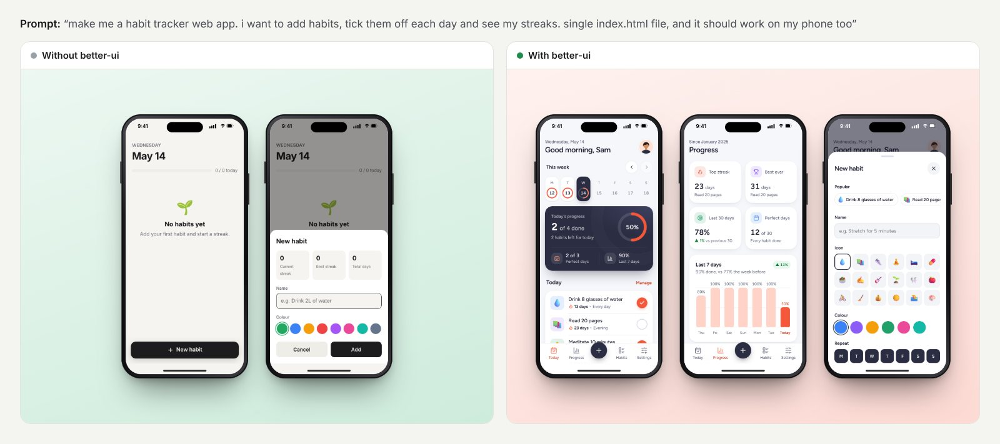
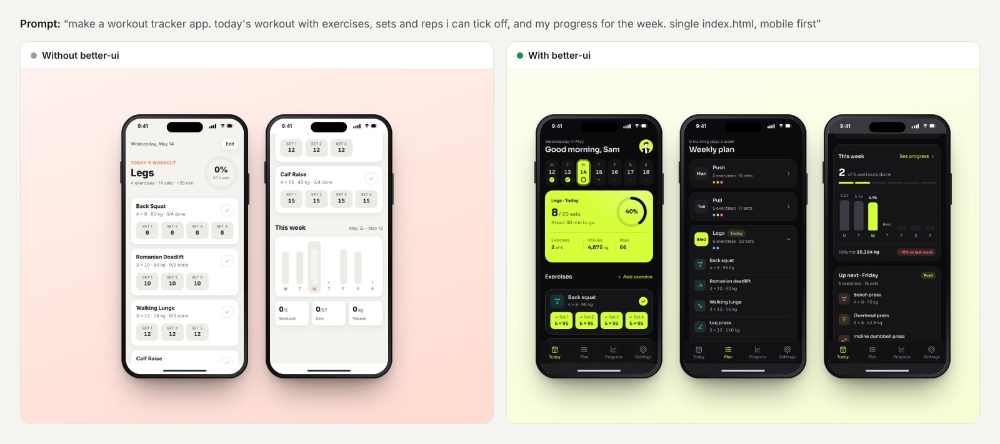
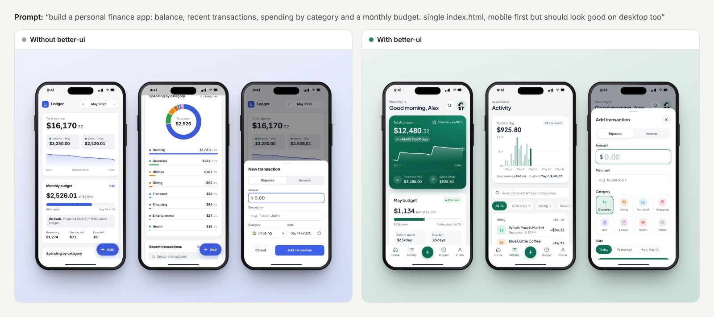
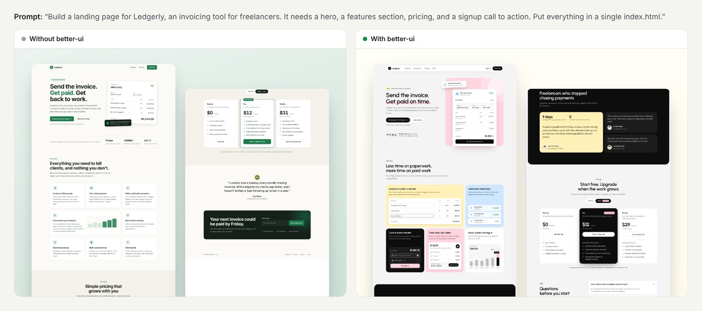
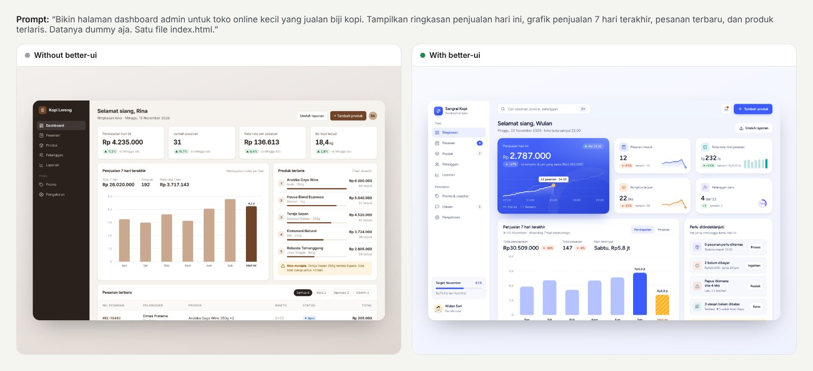
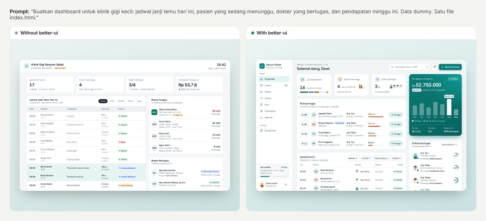
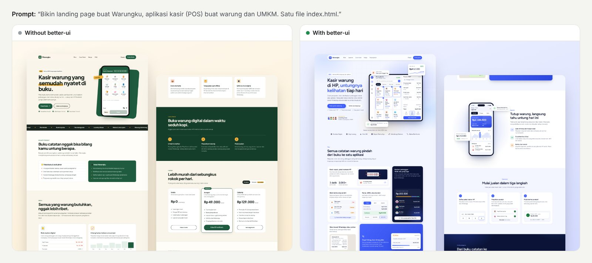

<div align="center">

# better-ui

**An agent skill that makes AI-built interfaces look like real, professionally designed products.**<br>
Not a generic template. Not an overdesigned AI concept. The thing a good product team would ship.

[](#install)
[](better-ui/SKILL.md)
[](#how-it-was-tested)
[](#whats-inside)



<sub>Same prompt, same model. Left: no skill. Right: with better-ui. The agent was never told the skill exists; it picked it up on its own.</sub>

</div>

---

## Why

Ask an AI agent for a dashboard, a landing page or an app and you get one of two things:

| Too plain | Too much |
|---|---|
| A page of default components. No brand, no hierarchy, nothing a designer drew. It reads as *rendered HTML*. | An invented theme pushed onto the interface: stamps, beads, paper textures, serif display fonts, clever copy. It reads as *a costume*. |

The work that gets popular on Dribbble sits in a narrow middle: **familiar patterns executed with precision**. A clean sans-serif, a light canvas, white cards, one brand colour, real content, consistent icons, one or two designed moments, and nothing out of place. better-ui teaches an agent to hit that middle every time.

## Before and after

Every pair below was built from **the same one-line prompt, by the same model**, each in a separate headless session in its own empty folder. The left session had no skills installed. The right session had better-ui installed and was never told about it. Nothing was hand-edited afterwards.

<table>
<tr><td width="50%">

**Workout tracker**


</td><td width="50%">

**Personal finance app**


</td></tr>
<tr><td width="50%">

**SaaS landing page**


</td><td width="50%">

**Store admin dashboard** *(prompt in Indonesian)*


</td></tr>
<tr><td width="50%">

**Dental clinic dashboard** *(never used while tuning the skill)*


</td><td width="50%">

**POS app landing page** *(never used while tuning the skill)*


</td></tr>
</table>

The pages themselves are in [`better-ui-workspace/before-after/`](better-ui-workspace/before-after), so you can open them in a browser.

## Results

Each page was hidden among **eight popular Dribbble shots of the same category**. A judge ranked all nine and flagged anything that looked AI-made ([method below](#how-it-was-tested)).

| Case | Rank among 9 | Judge's verdict |
|---|:---:|---|
| Habit tracker | **1st** | genuine |
| Dental clinic dashboard ✱ | **1st** | genuine |
| Workout tracker | **1st** | possibly AI-made |
| POS landing page, Indonesian ✱ | **1st** | possibly AI-made |
| Store admin dashboard | **1st** | possibly AI-made |
| SaaS landing page | **1st** and **3rd** | possibly AI-made |
| Personal finance app | **1st** and **7th** | possibly AI-made |

✱ Prompts never used while developing the skill.

For comparison, the same test placed the no-skill build **8th of 9** ("looks like rendered HTML or a template"), and an earlier version of this skill that pushed themed concepts also placed **8th** ("costume, not function").

## Install

**Claude Code**, for every project:

```bash
git clone https://github.com/zeative/better-ui-skills.git
```

```bash
cp -r better-ui-skills/better-ui ~/.claude/skills/
```

For one project only, copy it into that project's `.claude/skills/` folder instead:

```bash
mkdir -p .claude/skills && cp -r better-ui-skills/better-ui .claude/skills/
```

A packaged copy is in [`dist/better-ui.skill`](dist/better-ui.skill) for clients that install skills from a file.

The render-and-audit step uses Node and a Chromium that Playwright can drive. Without a browser the skill still works; it reviews the source instead of screenshots and says so.

## Usage

There is nothing to call. Ask for anything visual and the agent loads the skill when it fits:

```text
make me a habit tracker web app, single index.html, it should work on my phone too
```

```text
Bikin landing page buat Warungku, aplikasi kasir buat warung dan UMKM.
```

```text
restyle our settings page, it looks generic
```

It works for landing pages, dashboards, admin panels, mobile-first apps, components and forms, in plain HTML or any framework. In an existing codebase it follows your design system instead of bringing its own.

## How it works

```text
 1. Whose design is it?        existing product → fit its system; a brand → follow it; blank → continue
 2. Understand the job         what the screen is for, who uses it; write the real content first
 3. Set up the system          deal a contemporary look, one sans family, compact type scale, one brand colour
 4. Use the conventional layout native app anatomy · dashboard shell · landing sections, plus one signature chart
 5. Build it properly          every width, every state, accessibility floor, finish
 6. Render, audit, review      screenshot it, measure it, have a fresh reviewer ask "does this pass as real?"
 7. Hand off plainly           what was built, what is placeholder
```

A few rules that made the biggest difference:

- **No themes, no metaphors.** A habit tracker is not a stamp card and a budget is not an abacus. Character comes from colour, type, icons and finish.
- **Deal the look, don't pick it.** Left to choose, agents land on the same indigo gradient or emerald green every time. [`look.cjs`](better-ui/scripts/look.cjs) deals a contemporary palette and font per category, seeded by the product name.
- **Copy that gives a mock-up away is banned.** Captions that explain the chart, "These are sample habits", contradictions between parts of a screen, the stock set of merchants every generated finance app uses.
- **Open alive.** Apps ship with believable sample data in a mid-use state, so the first view is never an empty shell.
- **No browser defaults showing.** A native date picker inside an app screen is the fastest way to look like an HTML page.

## What's inside

```text
better-ui/
├── SKILL.md                 the process the agent follows
├── references/
│   ├── system.md            looks, type, colour by category, surfaces, icons, imagery, starting tokens
│   ├── product-ui.md        mobile apps, dashboards, admin; signature moments per category
│   ├── marketing.md         landing and pricing pages; the stock AI hero recipe to avoid
│   ├── editorial.md         portfolios, studios, restaurants and other image-led sites
│   ├── showpiece.md         summary cards, product mocks, charts, avatars, icons in code
│   ├── polish.md            surfaces, shadows, type, colour, controls, motion
│   ├── critique.md          what the bar looks like, the two failures, the reviewer brief
│   └── craft.md             the floor: contrast, type scale, layout, states, accessibility
└── scripts/
    ├── audit.cjs            renders a page at 3 widths and reports measured problems
    └── look.cjs             deals a contemporary look per category
```

No runtime dependencies. The skill is Markdown plus two Node scripts.

### `audit.cjs`

```bash
node better-ui/scripts/audit.cjs path/to/index.html --out .ui-audit
```

Renders at 375, 768 and 1440px, saves legible screenshot parts, and reports:

- **Broken:** horizontal overflow, console errors, text covered by other elements, content under fixed bars, words that run together.
- **Accessibility:** WCAG AA contrast, visible keyboard focus, labels, names, tap targets, heading order.
- **Craft:** textures and noise filters, serif display faces or a second text family on product UI, oversized type, the same icon reused for different items, clipped strings, half-empty cards, near-miss alignment, awkward wraps.
- **Richness:** a first screen with no visual, screens of text only, text on a bare page, a pastel rainbow.

Options: `--setup seed.js` runs a script in the page first (seed data, open a dialog), `--register showcase` relaxes card checks for image-led sites, plus `--dark`, `--widths` and `--json`.

### `look.cjs`

```bash
node better-ui/scripts/look.cjs "Tally" finance
```

```text
look:    fresh gradient
canvas:  #F3F6FB
brand:   #1F4BFF
accent:  #7DD3FC
font:    Plus Jakarta Sans
how:     deep blue payment card with a soft sky gradient, white glassy cards
```

## How it was tested

<details>
<summary><b>The line-up test</b></summary>

<br>

1. **Build in isolation.** Each page is built by a separate headless agent session in its own empty folder, from a one-line prompt that never mentions the skill.
2. **Present it like a shot.** The page is rendered the way Dribbble presents a design: phone screens in device frames, a dashboard in a browser window, or a landing page as a long scroll. The clock is frozen to a neutral date. ([`shot.cjs`](better-ui-workspace/tools/shot.cjs))
3. **Hide it in a line-up.** The shot is shuffled among eight popular Dribbble shots of the same category. ([`lineup.py`](better-ui-workspace/tools/lineup.py))
4. **Judge blind.** A judge is told only that some shots may be AI-made fakes that tend to look overdesigned. It ranks all nine and flags fakes. A page passes when it ranks in the top half and is not flagged as likely fake.

Before trusting the test, it was calibrated on pages whose quality was already known from a human reviewer. It ranked a no-skill page 8th ("rendered HTML"), and two themed-concept pages the human had rejected 8th as well ("costume, not function"). It agreed with the human every time.

</details>

<details>
<summary><b>What failed along the way</b></summary>

<br>

The skill went through about twenty rounds of build → judge → change. The full log, with every score and every reason, is in [`better-ui-workspace/dribbble-bar.md`](better-ui-workspace/dribbble-bar.md). The short version:

- **Restraint alone** produced honest pages that judges called wireframes.
- **A library of art directions and detailed showpieces** lifted scores, but the pages still read as templates.
- **"One ownable idea" per product** scored well with AI judges using a rubric, and produced stamp-card habit trackers and abacus budget apps that a human found forced and unprofessional. That rubric was the problem, so the test was replaced by the line-up.
- **Conventional anatomy, a strict system and plain copy** fixed the overdesign. Dealing the look, banning give-away copy and adding one signature chart fixed the remaining "generic template" verdicts.

</details>

<details>
<summary><b>Limits</b></summary>

<br>

- **The judges are AI models.** The line-up was calibrated against one person's judgement, not a panel of designers. Ranks move by a place or two between judges.
- **Finance is the hardest category.** Its reference shots are the strongest set, and results vary from 1st to 7th between builds.
- **It costs more than not using it:** roughly 10 to 20 minutes and 2 to 5 dollars per page, against 2 to 4 minutes without it, because it renders, audits and reviews its own work.
- **Sample content is placeholder.** Testimonials, logos and figures on marketing pages are fictional and must be replaced before publishing.
- **Tested on single-file HTML.** Work inside existing codebases follows the same instructions but was not part of the test set.

</details>

## Sources

Community descriptions of the problem:

- Adrian Krebs, [design slop analysis of 1,590 Show HN pages](https://www.adriankrebs.ch/blog/design-slop/) and [ai-design-checker](https://github.com/AdrianKrebs/ai-design-checker)
- Kosta Canatselis, [Spot the slop: a UI designer's guide to fixing AI defaults](https://world.hey.com/kostac/spot-the-slop-a-ui-designer-s-guide-to-fixing-ai-defaults-4c448c9c)
- The Fountain Institute, [signs of a vibe-coded UI](https://www.thefountaininstitute.com/blog/signs-vibe-coded-ui)
- codemyspec, [why vibe-coded websites look the same](https://codemyspec.com/blog/vibe-coded-websites-look-the-same)
- Aaron Ross, [The eyes have it: closing the agentic design loop](https://dev.to/ashmortar/the-eyes-have-it-closing-the-agentic-design-loop-3819)
- Hacker News threads [47864393](https://news.ycombinator.com/item?id=47864393), [49290499](https://news.ycombinator.com/item?id=49290499), [49867038](https://news.ycombinator.com/item?id=49867038)

Skills and writing this one learned from:

- Anthropic, [frontend-design skill](https://github.com/anthropics/skills/tree/main/skills/frontend-design), [Improving frontend design through Skills](https://claude.com/resources/articles/improving-frontend-design-through-skills) and [Harness design for long-running apps](https://www.anthropic.com/engineering/harness-design-long-running-apps)
- Paul Bakaus, [Impeccable](https://github.com/pbakaus/impeccable)
- [taste-skill](https://github.com/Leonxlnx/taste-skill) and [ui-ux-pro-max](https://github.com/nextlevelbuilder/ui-ux-pro-max-skill)
- Vercel, [Web Interface Guidelines](https://github.com/vercel-labs/web-interface-guidelines)
- Emil Kowalski, [design engineering skill](https://github.com/emilkowalski/skills); Jakub Krehel, [make-interfaces-feel-better](https://github.com/jakubkrehel/make-interfaces-feel-better)
- Matthew Butterick, [Practical Typography](https://practicaltypography.com/summary-of-key-rules.html); Evil Martians, [OKLCH in CSS](https://evilmartians.com/chronicles/oklch-in-css-why-quit-rgb-hsl)

The Dribbble reference shots used for judging are not stored in this repository.

<div align="center"><sub>3D icons in some outputs are Microsoft's <a href="https://github.com/microsoft/fluentui-emoji">Fluent Emoji</a> (MIT), loaded from a pinned CDN.</sub></div>
