<div align="center">


<br>

[](better-ui/SKILL.md)&nbsp;&nbsp;
[](#install)&nbsp;&nbsp;
[](#benchmarks)&nbsp;&nbsp;
[](#whats-inside)&nbsp;&nbsp;
[](LICENSE)

### Ask an agent for a page. Get something a design team would ship.

[Install](#install) · [Before and after](#before-and-after) · [What's different](#whats-different) · [Benchmarks](#benchmarks) · [How it works](#how-it-works) · [FAQ](#faq)

<br>

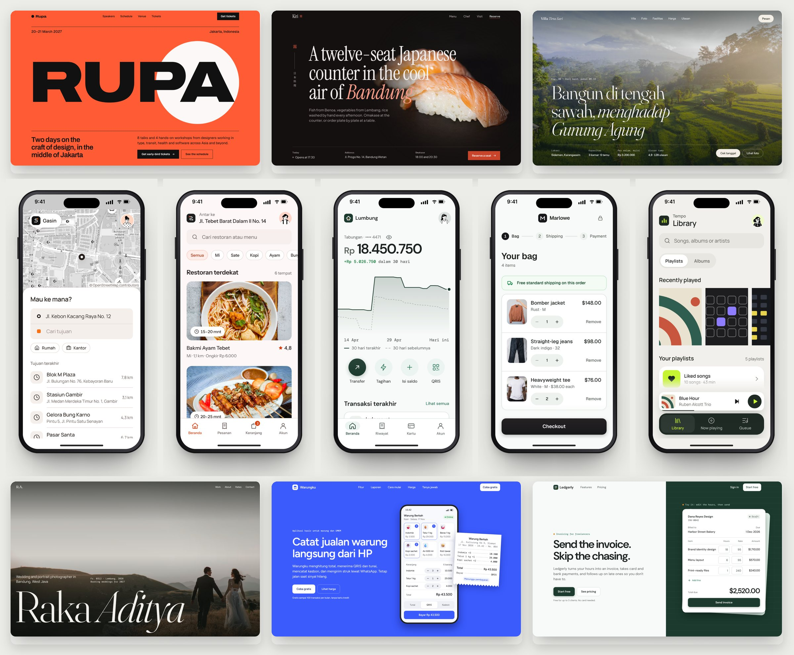

<sub>Every screen above was built by an agent from a one-line prompt, in one run, with no edits.</sub>

</div>

<br>

Left alone, AI agents build interfaces that are **too plain** (default components, no hierarchy, it reads as rendered HTML) or **too much** (invented themes, textures, a purple gradient, it reads as a template). **better-ui** is an agent skill that gives the agent what a good designer brings to the job: a fixed system of sizes and spaces, a colour system built from one brand colour, the conventional anatomy of each kind of screen, art direction for web pages, and the habit of rendering, measuring and reviewing its own work.

You don't call it. Ask for any screen and the agent loads it on its own.

## Install

```bash
npx skills add zeative/better-ui-skills
```

That uses the open [skills CLI](https://github.com/vercel-labs/skills) and works with Claude Code, Codex, Cursor and other agents that read `SKILL.md`. Or copy it yourself:

```bash
git clone https://github.com/zeative/better-ui-skills.git && cp -r better-ui-skills/better-ui ~/.claude/skills/
```

Then ask for something visual, in any language:

```text
landing page for a two-day design conference in Jakarta: speakers, schedule, venue, tickets
```

## Before and after

Same prompt, same model. Each page was built by a separate headless agent session in its own empty folder; the one on the right had better-ui installed and was never told about it. One run each, nothing edited, nothing picked.

<table>
<tr>
<td width="36%" align="center">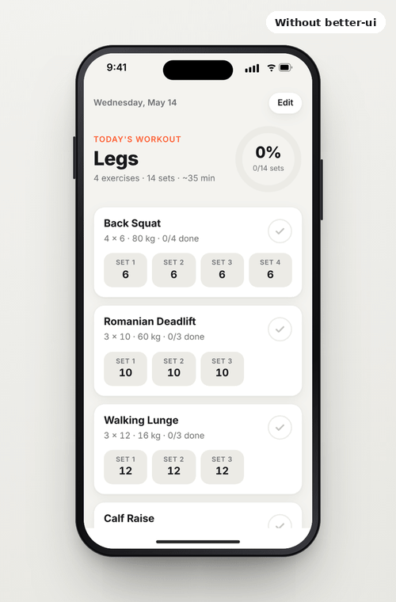</td>
<td width="64%" align="center"></td>
</tr>
<tr>
<td align="center"><sub><i>"make a workout tracker app. today's workout with exercises, sets and reps i can tick off, and my progress for the week"</i></sub></td>
<td align="center"><sub><i>"Bikin landing page buat Warungku, aplikasi kasir (POS) buat warung dan UMKM."</i></sub></td>
</tr>
</table>

<details open>
<summary><b>Web pages</b>: landing, event, restaurant, portfolio, property</summary>

<br>

For web pages the agent writes three concepts in different art directions, picks the strongest and carries it through every section, from the hero to the footer.

<table>
<tr><th width="50%">Without better-ui</th><th width="50%">With better-ui</th></tr>
<tr><td colspan="2"><b>Design conference</b> · <i>"landing page for a two-day design conference in Jakarta: speakers, schedule, venue, tickets with early-bird pricing. single index.html"</i></td></tr>
<tr>
<td><a href="docs/images/compare/conference-landing-before.jpg">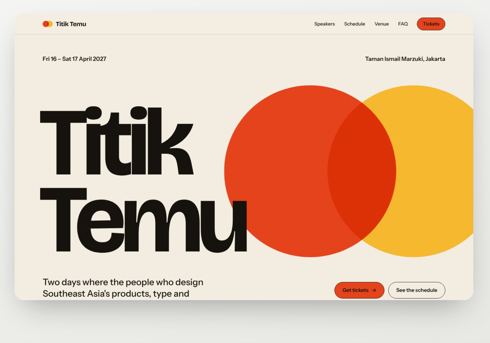</a></td>
<td><a href="docs/images/compare/conference-landing-after.jpg">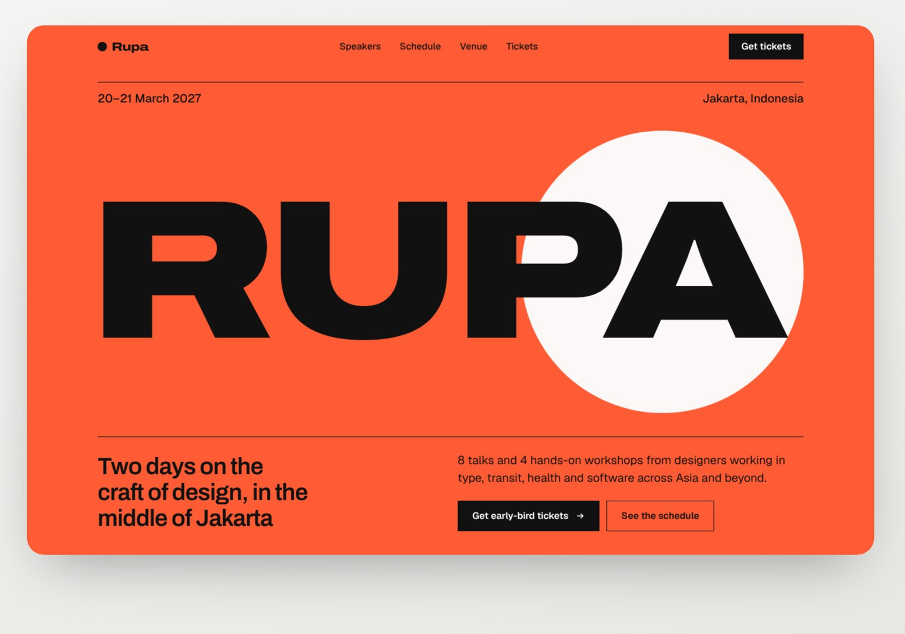</a></td>
</tr>
<tr><td colspan="2"><b>Japanese restaurant</b> · <i>"website for a small Japanese restaurant in Bandung: menu, story of the chef, reservations and location. single index.html"</i></td></tr>
<tr>
<td><a href="docs/images/compare/restaurant-site-before.jpg">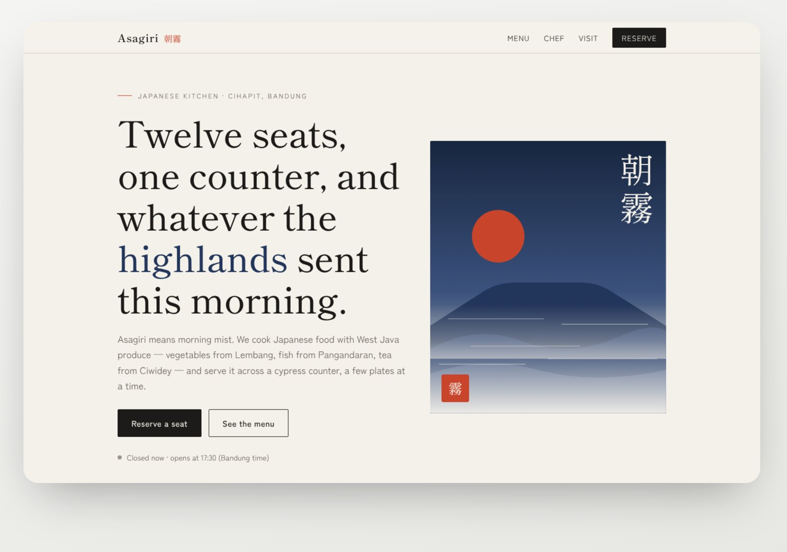</a></td>
<td><a href="docs/images/compare/restaurant-site-after.jpg">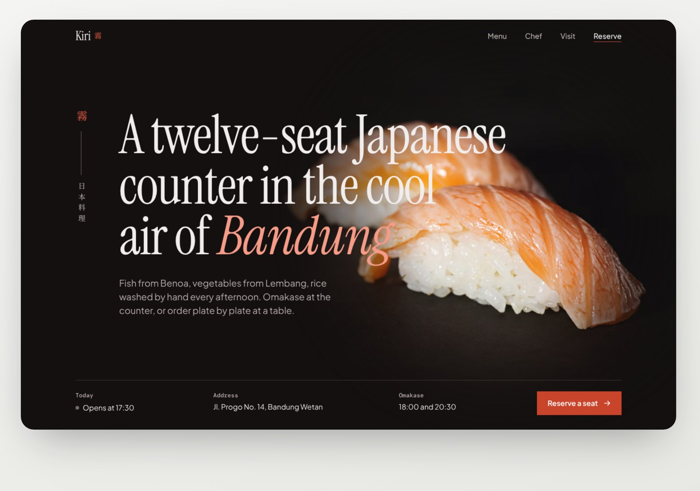</a></td>
</tr>
<tr><td colspan="2"><b>Wedding photographer</b> · <i>"I need a portfolio website for a freelance wedding and portrait photographer called Raka Aditya, based in Bandung. One index.html."</i></td></tr>
<tr>
<td><a href="docs/images/compare/photographer-portfolio-before.jpg">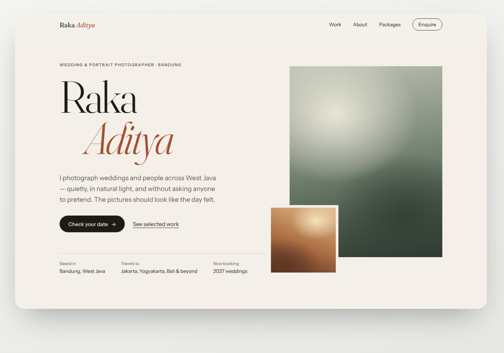</a></td>
<td><a href="docs/images/compare/photographer-portfolio-after.jpg">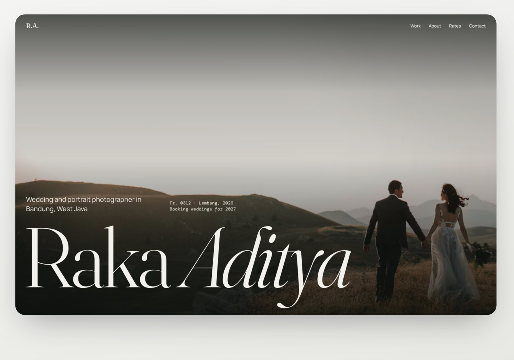</a></td>
</tr>
<tr><td colspan="2"><b>Bali villa</b> · <i>"Bikin landing page buat villa sewaan di Bali: foto, fasilitas, harga per malam, ulasan tamu, dan tombol booking. Satu file index.html."</i></td></tr>
<tr>
<td><a href="docs/images/compare/villa-landing-before.jpg"></a></td>
<td><a href="docs/images/compare/villa-landing-after.jpg">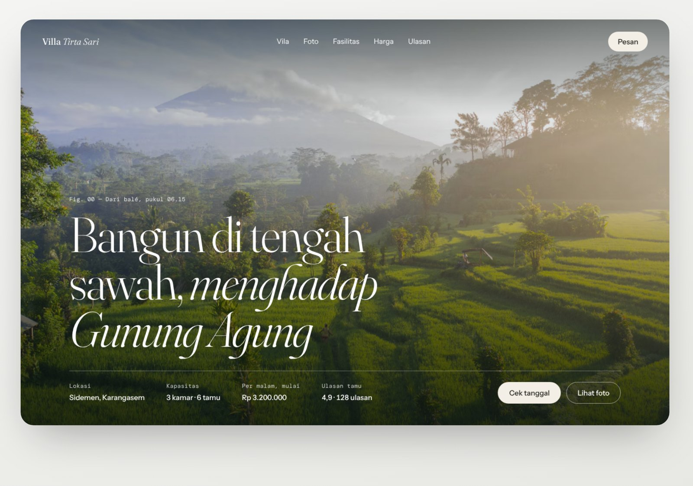</a></td>
</tr>
<tr><td colspan="2"><b>POS app for small shops</b> · <i>"Bikin landing page buat Warungku, aplikasi kasir (POS) buat warung dan UMKM. Satu file index.html."</i></td></tr>
<tr>
<td><a href="docs/images/compare/pos-landing-page-before.jpg">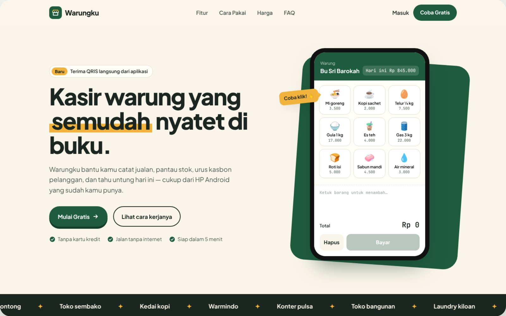</a></td>
<td><a href="docs/images/compare/pos-landing-page-after.jpg">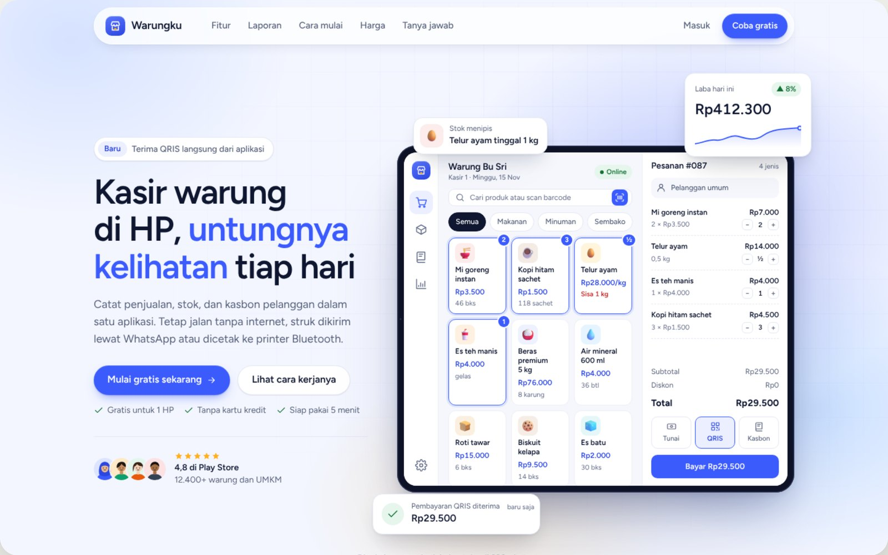</a></td>
</tr>
<tr><td colspan="2"><b>Invoicing SaaS</b> · <i>"Build a landing page for Ledgerly, an invoicing tool for freelancers. It needs a hero, a features section, pricing, and a signup call to action. Put everything in a single index.html."</i></td></tr>
<tr>
<td><a href="docs/images/compare/saas-landing-page-before.jpg"></a></td>
<td><a href="docs/images/compare/saas-landing-page-after.jpg"></a></td>
</tr>
</table>

</details>

<details>
<summary><b>Phone apps</b>: ordering, habits, crypto, workouts, sleep, music, recipes, money</summary>

<br>

<table>
<tr><th width="50%">Without better-ui</th><th width="50%">With better-ui</th></tr>
<tr><td colspan="2"><b>Coffee ordering app</b> · <i>"Bikin aplikasi pesan kopi buat kedai kopi kecil: menu, keranjang, dan status pesanan. Satu file index.html, mobile first."</i></td></tr>
<tr>
<td align="center"><a href="docs/images/compare/coffee-order-before.jpg"></a></td>
<td align="center"><a href="docs/images/compare/coffee-order-after.jpg"></a></td>
</tr>
<tr><td colspan="2"><b>Habit tracker</b> · <i>"make me a habit tracker web app. i want to add habits, tick them off each day and see my streaks. single index.html file, and it should work on my phone too"</i></td></tr>
<tr>
<td align="center"><a href="docs/images/compare/habit-tracker-app-before.jpg">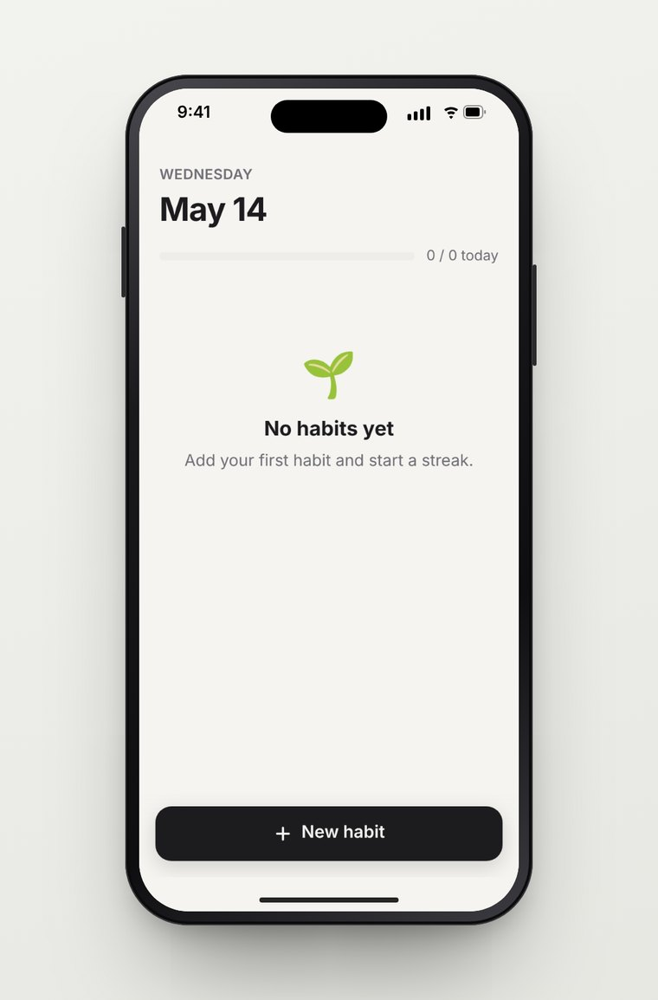</a></td>
<td align="center"><a href="docs/images/compare/habit-tracker-app-after.jpg"></a></td>
</tr>
<tr><td colspan="2"><b>Crypto portfolio</b> · <i>"build a crypto portfolio tracker app: total balance, holdings with price changes, a chart and recent transactions. single index.html, mobile first"</i></td></tr>
<tr>
<td align="center"><a href="docs/images/compare/crypto-portfolio-before.jpg"></a></td>
<td align="center"><a href="docs/images/compare/crypto-portfolio-after.jpg">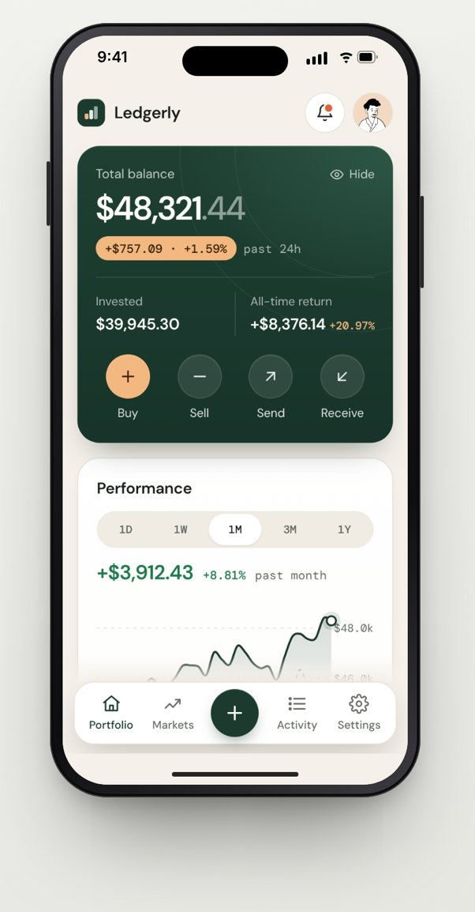</a></td>
</tr>
<tr><td colspan="2"><b>Workout tracker</b> · <i>"make a workout tracker app. today's workout with exercises, sets and reps i can tick off, and my progress for the week. single index.html, mobile first"</i></td></tr>
<tr>
<td align="center"><a href="docs/images/compare/workout-app-before.jpg">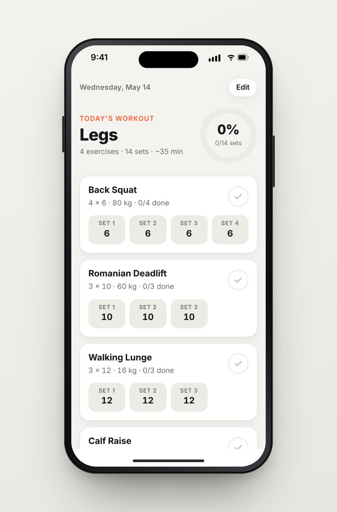</a></td>
<td align="center"><a href="docs/images/compare/workout-app-after.jpg">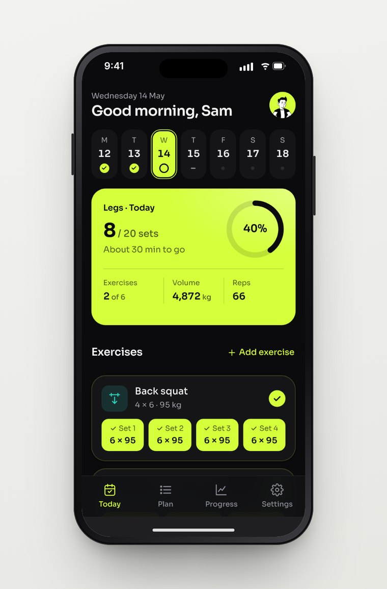</a></td>
</tr>
<tr><td colspan="2"><b>Meditation and sleep</b> · <i>"make a meditation and sleep app: today's session, a library of guided sessions, and a weekly mindfulness streak. single index.html, mobile first"</i></td></tr>
<tr>
<td align="center"><a href="docs/images/compare/meditation-app-before.jpg"></a></td>
<td align="center"><a href="docs/images/compare/meditation-app-after.jpg"></a></td>
</tr>
<tr><td colspan="2"><b>Music player</b> · <i>"make a music player app: now playing with controls, a queue, and a library of playlists. single index.html, mobile first"</i></td></tr>
<tr>
<td align="center"><a href="docs/images/compare/music-player-before.jpg">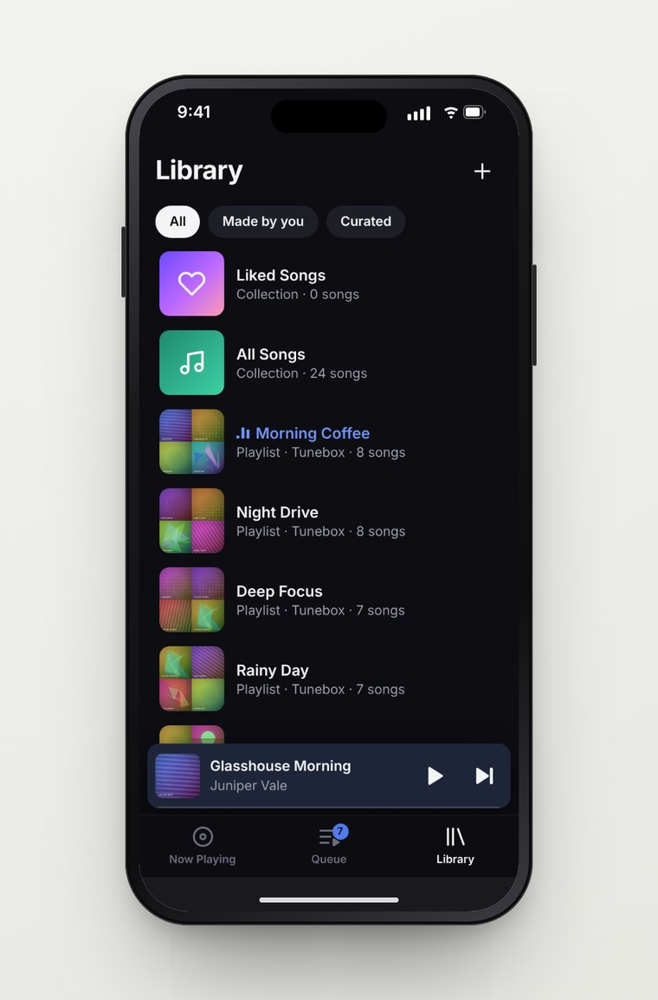</a></td>
<td align="center"><a href="docs/images/compare/music-player-after.jpg"></a></td>
</tr>
<tr><td colspan="2"><b>Recipe app</b> · <i>"make a recipe app: browse recipes by category, a recipe detail with ingredients and steps, and saved favourites. single index.html, mobile first"</i></td></tr>
<tr>
<td align="center"><a href="docs/images/compare/recipe-app-before.jpg"></a></td>
<td align="center"><a href="docs/images/compare/recipe-app-after.jpg"></a></td>
</tr>
<tr><td colspan="2"><b>Personal finance</b> · <i>"build a personal finance app: balance, recent transactions, spending by category and a monthly budget. single index.html, mobile first but should look good on desktop too"</i></td></tr>
<tr>
<td align="center"><a href="docs/images/compare/finance-app-before.jpg"></a></td>
<td align="center"><a href="docs/images/compare/finance-app-after.jpg">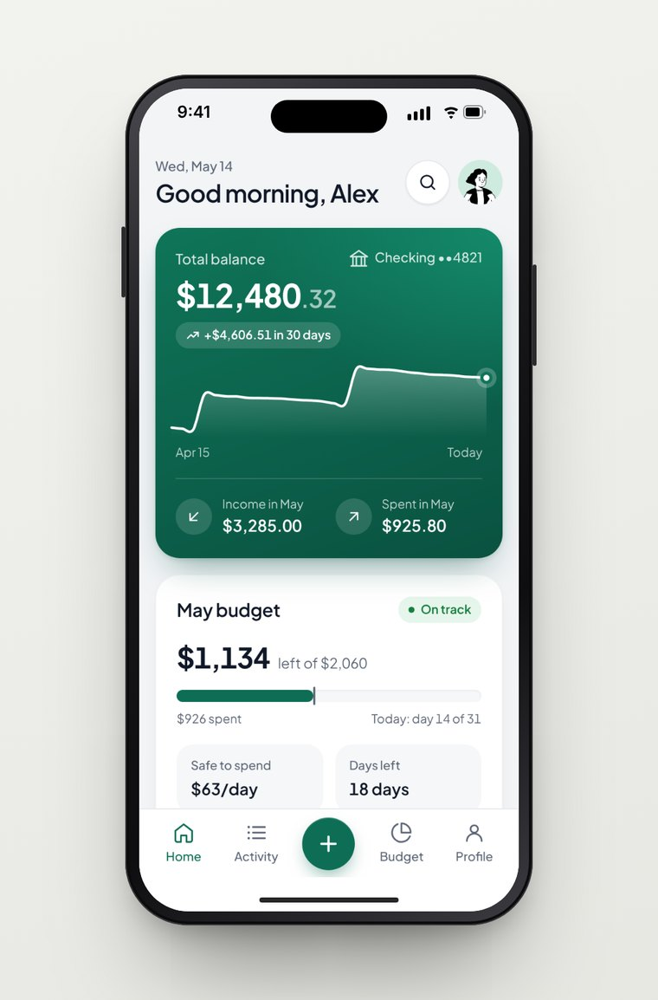</a></td>
</tr>
</table>

</details>

<details>
<summary><b>Dashboards and tools</b>: clinic, store admin, analytics, kanban, school</summary>

<br>

<table>
<tr><th width="50%">Without better-ui</th><th width="50%">With better-ui</th></tr>
<tr><td colspan="2"><b>Dental clinic dashboard</b> · <i>"Buatkan dashboard untuk klinik gigi kecil: jadwal janji temu hari ini, pasien yang sedang menunggu, dokter yang bertugas, dan pendapatan minggu ini. Data dummy. Satu file index.html."</i></td></tr>
<tr>
<td><a href="docs/images/compare/clinic-dashboard-before.jpg">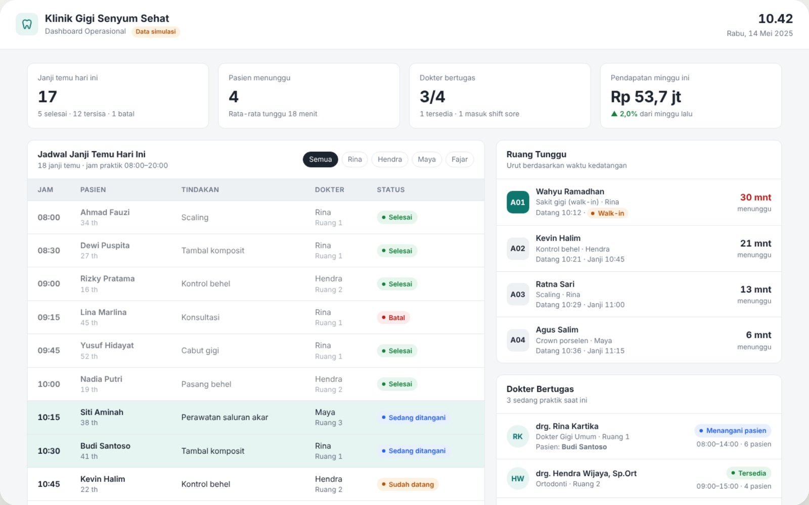</a></td>
<td><a href="docs/images/compare/clinic-dashboard-after.jpg">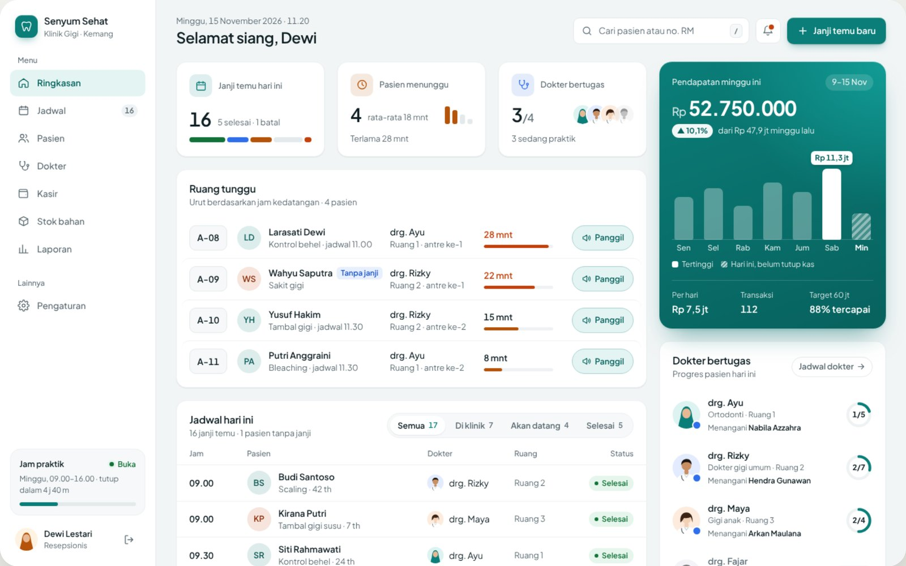</a></td>
</tr>
<tr><td colspan="2"><b>Store admin dashboard</b> · <i>"Bikin halaman dashboard admin untuk toko online kecil yang jualan biji kopi. Tampilkan ringkasan penjualan hari ini, grafik penjualan 7 hari terakhir, pesanan terbaru, dan produk terlaris. Datanya dummy aja. Satu file index.html."</i></td></tr>
<tr>
<td><a href="docs/images/compare/store-admin-dashboard-before.jpg">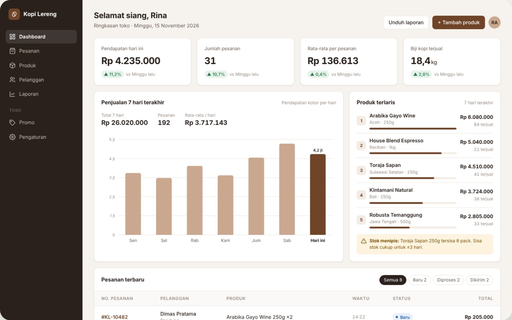</a></td>
<td><a href="docs/images/compare/store-admin-dashboard-after.jpg"></a></td>
</tr>
<tr><td colspan="2"><b>SaaS analytics</b> · <i>"build a web analytics dashboard for a SaaS product: visitors, signups, conversion, traffic sources and top pages. dummy data, single index.html"</i></td></tr>
<tr>
<td><a href="docs/images/compare/analytics-dashboard-before.jpg"></a></td>
<td><a href="docs/images/compare/analytics-dashboard-after.jpg">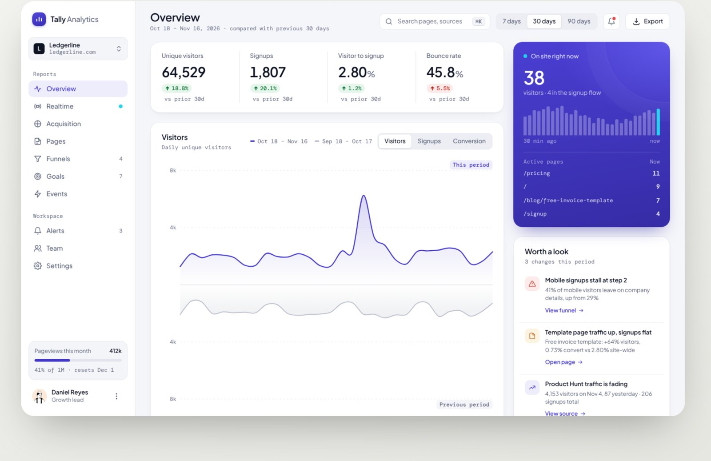</a></td>
</tr>
<tr><td colspan="2"><b>Kanban board</b> · <i>"make a kanban board web app for a small product team: columns, task cards with assignees and due dates, and a way to add tasks. single index.html"</i></td></tr>
<tr>
<td><a href="docs/images/compare/kanban-board-before.jpg"></a></td>
<td><a href="docs/images/compare/kanban-board-after.jpg"></a></td>
</tr>
<tr><td colspan="2"><b>Student dashboard</b> · <i>"Bikin dashboard siswa untuk aplikasi belajar online: jadwal kelas hari ini, tugas yang belum dikumpulkan, nilai, dan progres kursus. Data dummy, satu file index.html."</i></td></tr>
<tr>
<td><a href="docs/images/compare/student-dashboard-before.jpg">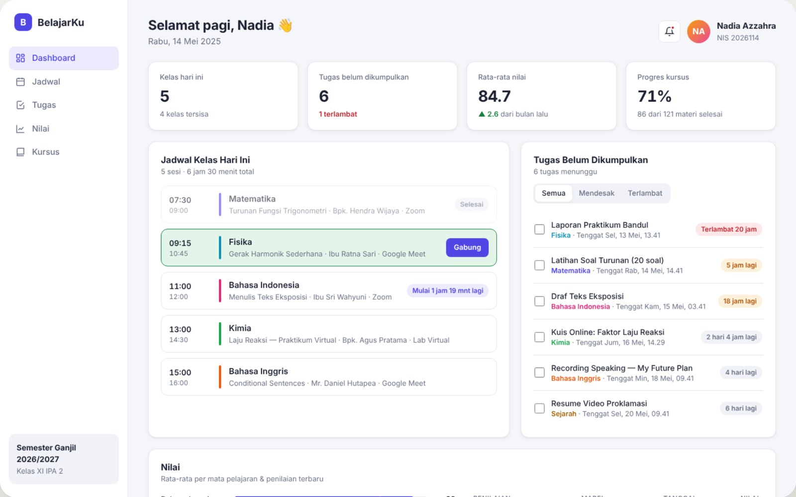</a></td>
<td><a href="docs/images/compare/student-dashboard-after.jpg">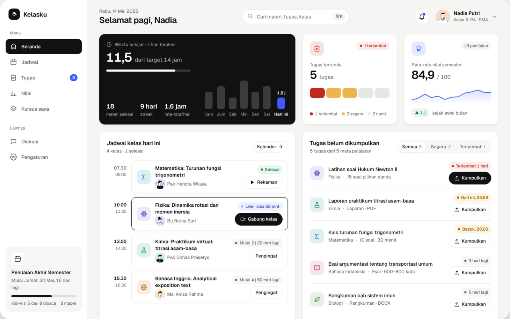</a></td>
</tr>
</table>

</details>

<details>
<summary><b>Shops and pricing</b>: product pages, a category page, pricing</summary>

<br>

<table>
<tr><th width="50%">Without better-ui</th><th width="50%">With better-ui</th></tr>
<tr><td colspan="2"><b>Pricing page</b> · <i>"build a pricing page for a design tool with three plans, a monthly/yearly toggle, a feature comparison table and an FAQ. single index.html"</i></td></tr>
<tr>
<td><a href="docs/images/compare/pricing-page-before.jpg">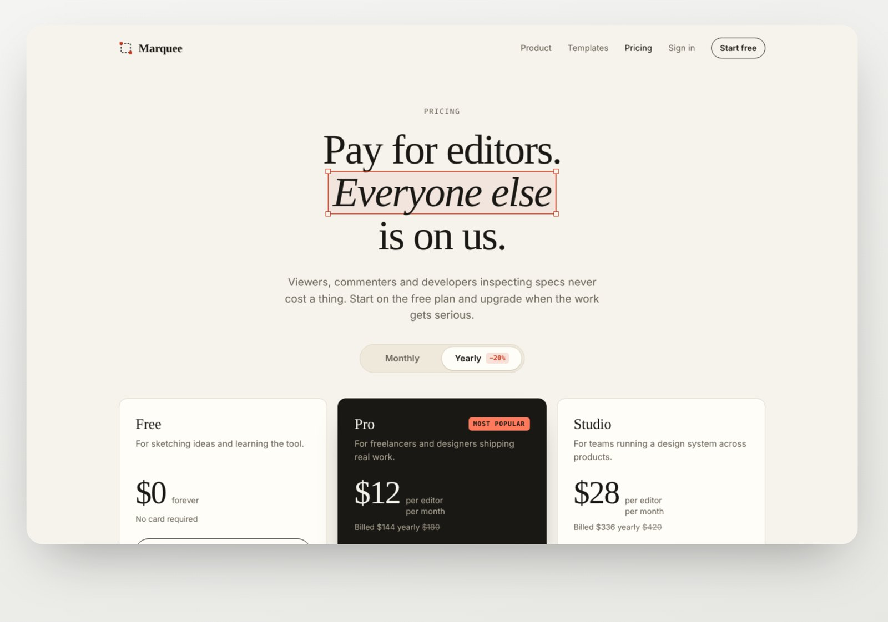</a></td>
<td><a href="docs/images/compare/pricing-page-after.jpg">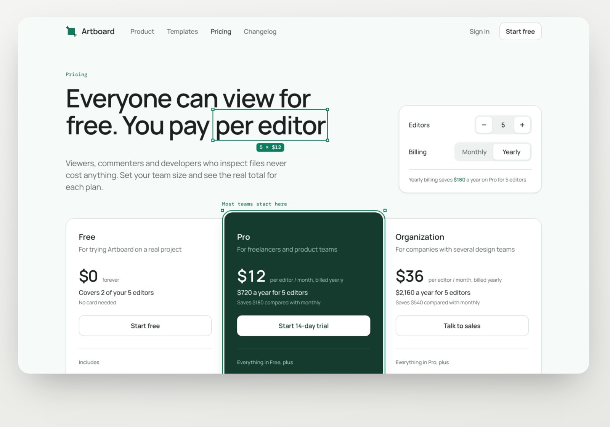</a></td>
</tr>
<tr><td colspan="2"><b>Usage-based pricing</b> · <i>"pricing page for a product analytics tool that charges by monthly tracked users. plans, a comparison and FAQ. single index.html"</i></td></tr>
<tr>
<td><a href="docs/images/compare/pricing-analytics-before.jpg">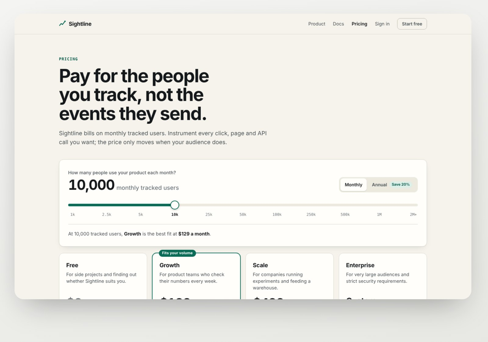</a></td>
<td><a href="docs/images/compare/pricing-analytics-after.jpg">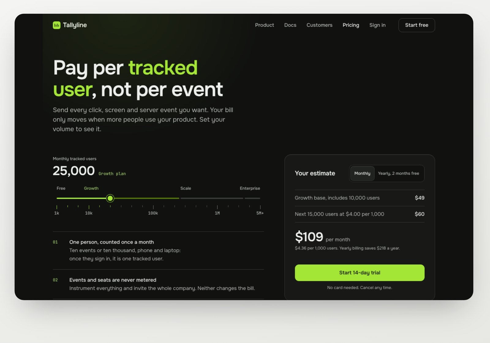</a></td>
</tr>
<tr><td colspan="2"><b>Sneaker product page</b> · <i>"build a product page for an online sneaker store: gallery, sizes, colours, price, reviews and add to cart. single index.html"</i></td></tr>
<tr>
<td><a href="docs/images/compare/sneaker-product-before.jpg"></a></td>
<td><a href="docs/images/compare/sneaker-product-after.jpg"></a></td>
</tr>
<tr><td colspan="2"><b>Skincare product page</b> · <i>"Bikin halaman produk untuk brand skincare lokal: serum vitamin C, dengan galeri, varian ukuran, harga, ulasan, dan tombol tambah ke keranjang. Satu file index.html."</i></td></tr>
<tr>
<td><a href="docs/images/compare/skincare-product-before.jpg">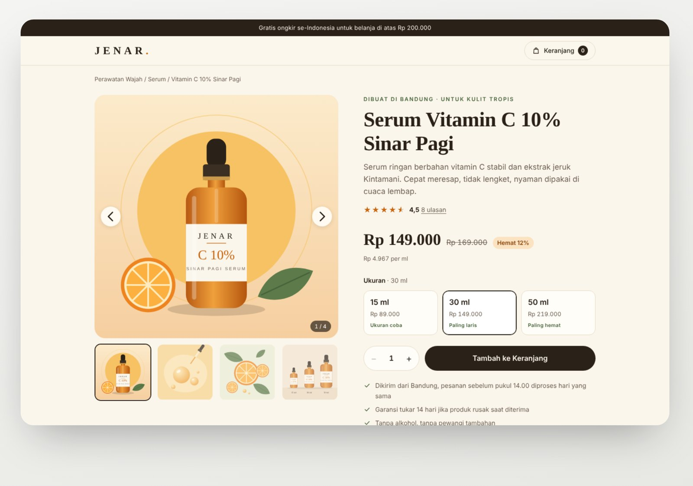</a></td>
<td><a href="docs/images/compare/skincare-product-after.jpg">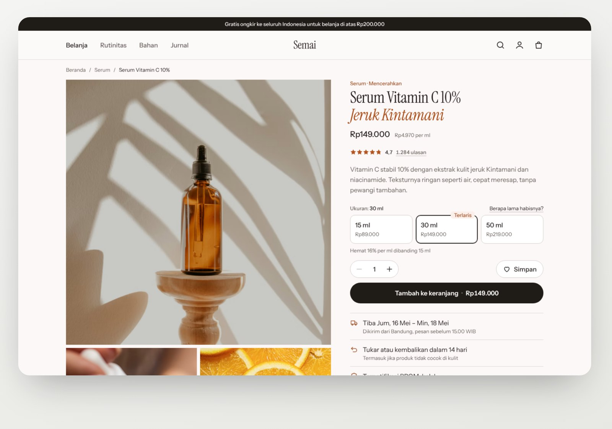</a></td>
</tr>
<tr><td colspan="2"><b>Furniture category page</b> · <i>"build the category page of an online furniture store: filters, sorting, product grid, and a slide-out cart. single index.html"</i></td></tr>
<tr>
<td><a href="docs/images/compare/shop-listing-before.jpg">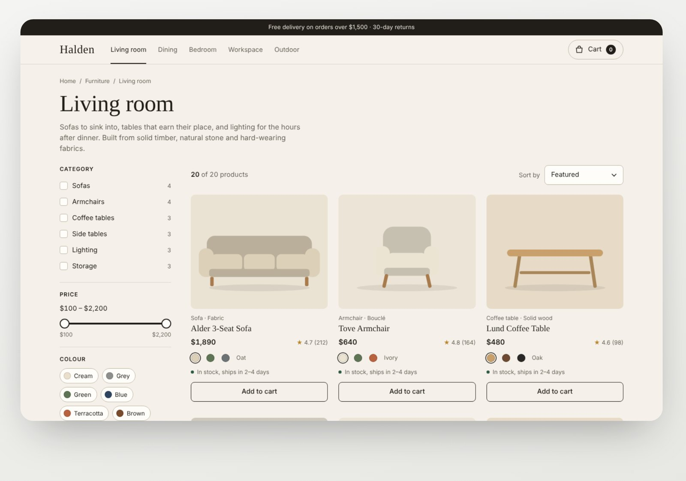</a></td>
<td><a href="docs/images/compare/shop-listing-after.jpg">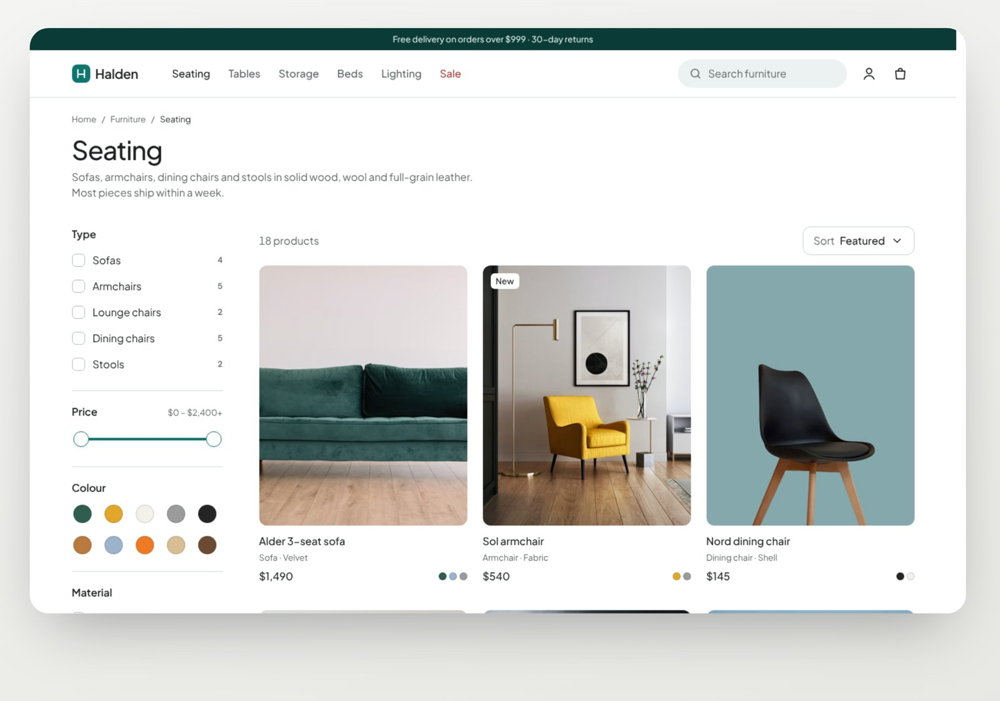</a></td>
</tr>
</table>

</details>

Every page is in [`examples/`](examples), with its prompt. Open them in a browser and click around.

## What's different

Most UI skills are a list of taste rules. This one is a system an agent can follow and measure:

| | What the agent gets | Where |
|:---|:---|:---|
| **Fixed values, not adjectives** | One value for every size, space, radius and type style per context (phone, desktop app, data tool, landing page), taken from Apple's and Google's guidelines, Refactoring UI, Practical UI and Nielsen Norman Group. Five type sizes per screen, spacing on one scale. | [`spec.md`](better-ui/references/spec.md), [`tokens.css`](better-ui/assets/tokens.css) |
| **Colour with depth** | One brand colour becomes a 12-step scale, greys tinted toward it, status colours, tinted shadows and role tokens, in OKLCH, light and dark. The brand is used at several strengths, so screens stop looking flat. | [`palette.cjs`](better-ui/scripts/palette.cjs), [`color.md`](better-ui/references/color.md) |
| **Hierarchy you can check** | Laws of perception (Gestalt, Fitts, Hick, von Restorff) as rules, plus a review method: predicted gaze order, squint test, five-second test, heuristics. | [`ux-laws.md`](better-ui/references/ux-laws.md), [`hierarchy.md`](better-ui/references/hierarchy.md) |
| **Art direction for the web** | Twelve directions researched from current award-winning sites (poster, editorial serif, cinematic photo, Swiss catalogue, live product demo and more). Explore three, commit to one, carry it everywhere. | [`web-directions.md`](better-ui/references/web-directions.md) |
| **The right anatomy per kind** | Native app anatomy, the dashboard shell, dense pro tools edge to edge, product pages with a sticky buy box, pricing that answers the buyer's questions. | [`product-ui.md`](better-ui/references/product-ui.md), [`commerce.md`](better-ui/references/commerce.md), [`marketing.md`](better-ui/references/marketing.md) |
| **Type and words that fit** | Faces chosen for the character, tracking and leading by size, a mono partner for meta; copy written for the space it sits in, in the user's language. | [`typography.md`](better-ui/references/typography.md), [`copy.md`](better-ui/references/copy.md) |
| **Real content** | Real photographs, real maps, believable sample data in a mid-use state. No lorem ipsum, no grey boxes, no stock merchant names. | [`system.md`](better-ui/references/system.md) |
| **It checks its own work** | Renders every page at three widths and measures overflow, overlap, contrast, tap targets, spacing off the scale, font-size count, flat colour, then reviews the screenshots. | [`audit.cjs`](better-ui/scripts/audit.cjs) |

On web pages the system is a floor, not a ceiling: a chosen direction may bring its own display face, giant type, colour fields and motion.

## Benchmarks

Over forty prompts across phone apps, dashboards, data tools, web pages and shops, each built twice in isolated sessions (with and without the skill), one run each, and shown as they came out. The audit numbers below are measured, not judged.

**Ten unseen prompts** (ride hailing, CI/CD dashboard, conference, checkout, email client, property listings, mobile banking, SaaS billing, restaurant, language learning):

| Measured by `audit.cjs` | Without better-ui | With better-ui |
|:---|:---:|:---:|
| Pages with a broken layout (overflow, covered text, overlaps) | 5 of 10 | 0 of 10 ✱ |
| Font sizes on the first screen | 5 to 20 | 4 to 6 |

<sub>✱ After fixing one false positive in the audit itself (preview text clipped with an ellipsis was counted as covered).</sub>

**An earlier set of seventeen prompts**: spacing values off the 4px scale went from 16 to 186 per page without the skill to 0 on 16 of 17 pages with it.

Side by side, judged by eye: of the ten unseen prompts, better-ui was clearly better on five, about the same on four, and worse on one (the conference page, which looked like a SaaS page; the poster direction was added and it now leads). On nine web pages after the art directions were added, it was better on seven and about the same on the two most conventional ones (a pricing page and a product page), which led to the pricing and commerce guidance. With it, both lead: pricing pages now open with a live calculator, and product pages use real photography, a sticky buy box and a story section (see Shops and pricing). Across these five shop and pricing prompts, pages without the skill used 11 to 20 font sizes; with it, 4 to 6.

<details>
<summary><b>Earlier: hidden among Dribbble shots</b></summary>

<br>

An earlier version was tested by hiding each page among eight popular Dribbble shots of the same category and asking a judge to rank all nine and flag anything that looked AI-made.

| Case | Rank among 9 | Judged |
|:---|:---:|:---|
| Habit tracker | **1st** | genuine |
| Dental clinic dashboard ✱ | **1st** | genuine |
| Workout tracker | **1st** | possibly AI-made |
| POS landing page ✱ | **1st** | possibly AI-made |
| Store admin dashboard | **1st** | possibly AI-made |
| SaaS landing page | **1st**, **3rd** | possibly AI-made |
| Personal finance app | **1st**, **7th** | possibly AI-made |

<sub>✱ Prompts never used while developing the skill. On the same test, a page built without the skill ranked 8th of 9. The judge was calibrated against one person's verdicts on earlier pages and agreed every time.</sub>

</details>

<details>
<summary><b>What failed along the way</b></summary>

<br>

- **Restraint alone** produced honest pages that judges called wireframes.
- **"One ownable idea" per product** produced stamp-card habit trackers and abacus budget apps: themed, forced, a costume.
- **Taste rules with ranges** ("16 to 24px padding") let the agent drift; fixing one value per context removed most of the inconsistency.
- **Pastel cards and big colour blocks** read as generated; neutral surfaces with the brand at several strengths fixed it.
- **The conventional layout everywhere** made web pages safe and forgettable; art direction for web pages, with the system as a floor, fixed that.

</details>

## How it works

```text
1. Whose design is it?       existing product → fit its system · a brand → follow it · blank → continue
2. Understand the job        what the screen is for and who uses it; write the real content first
3. Set up the system         deal a look; the palette from one brand colour; fixed spec and tokens
4. Layout or direction       app anatomy · dashboard shell · shop · a committed art direction for web pages
5. Build it properly         every width, every state, the accessibility floor, the finish
6. Render, audit, review     screenshots at 3 widths, measured problems, review by method, fix
7. Hand off plainly          what was built and what is placeholder
```

## What's inside

```text
better-ui/
├── SKILL.md                 the process the agent follows
├── assets/
│   ├── tokens.css           spacing, radius, type ramp, motion: copied into every build
│   └── kits/                eight coherent design kits: precision, precision-dark, editorial, swiss, soft, civic, showroom, warm
├── references/
│   ├── improve.md           improving an existing UI: measure, scope, keep what must not break, work in the stack
│   ├── references.md        find references in design galleries, break them down, slice
│   ├── kits.md              choosing and using a kit: one decision for type, colour, radius and depth
│   ├── spec.md              one fixed value for every size, space, radius and colour role
│   ├── color.md             colour with depth: scale steps and their jobs, surfaces, tints, charts
│   ├── web-directions.md    twelve art directions for web pages; explore three, commit to one
│   ├── typography.md        faces, pairing, weights, tracking and leading by size
│   ├── hierarchy.md         levels, grouping, numbers, tables, charts, button weight
│   ├── ux-laws.md           Gestalt, Fitts, Hick and the method used to review every render
│   ├── copy.md              copy that fits its layout; lengths per element, locale
│   ├── system.md            looks, surfaces, icons, imagery, photos and maps
│   ├── product-ui.md        mobile apps, dashboards, admin, dense pro tools
│   ├── marketing.md         landing and pricing pages
│   ├── commerce.md          product pages, listings, the bag and checkout
│   ├── public-sector.md     government sites: top tasks, life events, identity from the emblem
│   ├── editorial.md         portfolios, studios, restaurants and other image-led sites
│   ├── showpiece.md         summary cards, product mocks, charts, avatars, icons in code
│   ├── polish.md            micro-details, controls, motion
│   ├── critique.md          the bar, the failure modes, the reviewer brief
│   └── craft.md             contrast, layout, states, accessibility
└── scripts/
    ├── refs.cjs             searches Dribbble by topic and screenshots live sites into a reference board
    ├── match.cjs            measures references (pixel grid, palette) and compares your screen with them
    ├── audit.cjs            renders a page at 3 widths and reports measured problems
    ├── look.cjs             deals a contemporary look per category
    └── palette.cjs          turns one brand colour into the full colour system
```

Markdown, stylesheets and five Node scripts. No runtime dependencies.

<details>
<summary><b><code>audit.cjs</code>: what it measures</b></summary>

<br>

```bash
node better-ui/scripts/audit.cjs path/to/index.html --out .ui-audit
```

| Group | Checks |
|:---|:---|
| Broken | horizontal overflow, console errors, text covered by other elements, content under fixed bars, failed requests |
| Accessibility | WCAG AA contrast, visible focus, labels and names, tap targets, heading order |
| Spec | spacing off the scale, more than five font sizes, a boxed main chart, colour blocks over 15%, pastel fills |
| Colour | tinted backgrounds, coloured text, untinted greys, black shadows: flags flat colour |
| Craft | near-miss alignment, uneven gutters, clipped text, awkward wraps, squeezed text columns |
| Inventory | font sizes, families, weights, colours, radii, and a predicted gaze order with a squint screenshot |

Options: `--register showcase` for web pages with an art direction, `--register dense` for professional data tools, `--widths 1280,1440` for desktop-only briefs, plus `--setup`, `--dark` and `--json`. It needs Node and a Chromium that Playwright can drive.

</details>

<details>
<summary><b><code>look.cjs</code> and <code>palette.cjs</code>: a look and a colour system</b></summary>

<br>

```console
$ node better-ui/scripts/look.cjs "Tally" finance
look:    fresh gradient
brand:   #1F4BFF
accent:  #7DD3FC
font:    Plus Jakarta Sans
mono:    DM Mono (meta, axis labels, counts)
how:     deep blue payment card with a soft sky gradient, white glassy cards
palette: node better-ui/scripts/palette.cjs "#1F4BFF"
```

Same product name, same look, every time, so the agent does not land on the indigo every generated app uses. Categories: finance, crypto, fitness, habits, wellness, sleep, health, productivity, commerce, saas, food, travel, media, other.

```bash
node better-ui/scripts/palette.cjs "#1F4BFF"                     # light, plus a dark block
node better-ui/scripts/palette.cjs "#A3E635" --dark              # dark-first
node better-ui/scripts/palette.cjs "#16A34A" --solid "#111111"   # monochrome: black controls, green tints
```

`palette.cjs` builds a 12-step brand scale and a 12-step neutral scale tinted toward the brand hue (OKLCH, with the step roles of Radix Colors), status colours, role tokens and tinted shadows. It picks white or dark text for the brand by contrast, lifts a deep brand for dark themes, and prints the contrast of each text role.

</details>

## FAQ

**Which agents does it work with?**
It was built and tested with Claude Code. The format is the open `SKILL.md` standard, so agents that support skills can load it; the render-and-audit step needs one that can run Node.

**Does it limit the agent's creativity?**
On product UI it keeps the agent on the conventional pattern, because that is what makes apps easy to use. On web pages it asks for more creativity, not less: the agent has to explore three directions and commit to a bold one, and the system only guarantees legibility and finish.

**Will it restyle my existing app?**
No. In a codebase with a design system it reads your tokens and components and works inside them. Before changing a screen it audits it and sizes the change to what it found.

**Does it need a browser?**
For the audit, yes: Node plus a Chromium that Playwright can drive. Without one the skill still works and reviews the source instead, and says so.

**Why not just write a better prompt?**
A prompt can ask for "clean and modern". The skill brings what a prompt can't carry: fixed values, a colour system, the anatomy of each kind of screen, researched directions, a list of give-aways, an audit that measures the result, and a review loop.

**What does it cost?**
Roughly 5 to 20 minutes per page, against 3 to 10 without it, because it renders, audits and reviews its own work.

**Is the sample content real?**
No. Names, figures, testimonials and logos are fictional; photographs are from Unsplash. Replace them before you publish anything.

## Sources

<details>
<summary>Design research, writing on the problem, and skills this one learned from</summary>

<br>

Design systems and research behind the fixed values and the colour system:

- Apple, [Human Interface Guidelines](https://developer.apple.com/design/human-interface-guidelines); Google, [Material 3](https://m3.material.io/)
- Adam Wathan and Steve Schoger, [Refactoring UI](https://www.refactoringui.com/); Adham Dannaway, [Practical UI](https://www.practical-ui.com/); Erik Kennedy, [Learn UI Design](https://www.learnui.design/)
- Nielsen Norman Group, [articles on visual hierarchy and usability](https://www.nngroup.com/); Jon Yablonski, [Laws of UX](https://lawsofux.com/)
- [Radix Colors](https://www.radix-ui.com/colors) (12-step scales); Evil Martians, [OKLCH in CSS](https://evilmartians.com/chronicles/oklch-in-css-why-quit-rgb-hsl); Josh Comeau, [designing shadows](https://www.joshwcomeau.com/css/designing-shadows/)
- Stephen Few and Edward Tufte on charts; Datawrapper on colour in data visualisation; Baymard Institute on e-commerce
- [Awwwards](https://www.awwwards.com/websites/sites_of_the_day/), [siteinspire](https://www.siteinspire.com/) and [Httpster](https://httpster.net/) for the web directions

On AI-made interfaces:

- Adrian Krebs, [design slop analysis of 1,590 Show HN pages](https://www.adriankrebs.ch/blog/design-slop/) and [ai-design-checker](https://github.com/AdrianKrebs/ai-design-checker)
- Kosta Canatselis, [Spot the slop](https://world.hey.com/kostac/spot-the-slop-a-ui-designer-s-guide-to-fixing-ai-defaults-4c448c9c); The Fountain Institute, [signs of a vibe-coded UI](https://www.thefountaininstitute.com/blog/signs-vibe-coded-ui)
- Aaron Ross, [The eyes have it: closing the agentic design loop](https://dev.to/ashmortar/the-eyes-have-it-closing-the-agentic-design-loop-3819)

Skills and writing this one learned from:

- Anthropic, [frontend-design skill](https://github.com/anthropics/skills/tree/main/skills/frontend-design) and [Improving frontend design through Skills](https://claude.com/resources/articles/improving-frontend-design-through-skills)
- Damir Sokolovsky, [unslop](https://github.com/heydamir/unslop) (CC BY 4.0): sizing the change to an audit, stat tiles as plain numbers, chart hierarchy
- Paul Bakaus, [Impeccable](https://github.com/pbakaus/impeccable); [taste-skill](https://github.com/Leonxlnx/taste-skill); [ui-ux-pro-max](https://github.com/nextlevelbuilder/ui-ux-pro-max-skill)
- Vercel, [Web Interface Guidelines](https://github.com/vercel-labs/web-interface-guidelines); Emil Kowalski, [design engineering skill](https://github.com/emilkowalski/skills); Matthew Butterick, [Practical Typography](https://practicaltypography.com/summary-of-key-rules.html)

3D icons in some outputs are Microsoft's [Fluent Emoji](https://github.com/microsoft/fluentui-emoji) (MIT). Photographs in the examples are from [Unsplash](https://unsplash.com/license).

</details>

## License

[MIT](LICENSE). Use it, fork it, ship it.

<div align="center">

<br>


<sub>If better-ui made your agent's UI better, a ⭐ helps others find it.</sub>

[](https://star-history.com/#zeative/better-ui-skills&Date)

</div>
